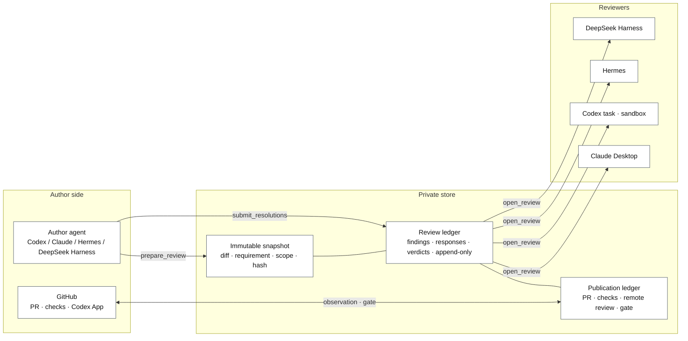
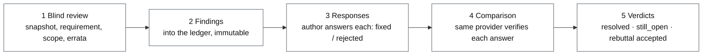
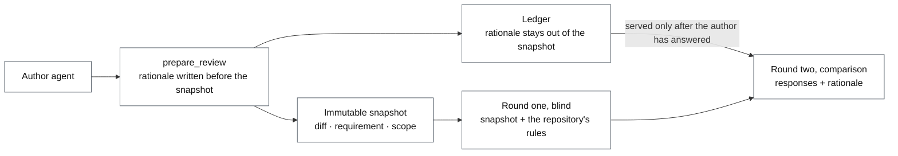
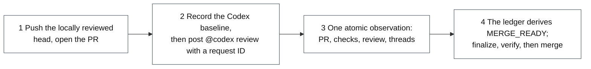

# Review Bridge: product overview

[中文版](overview.zh.md)

Review Bridge is a code-review handoff for changes written by AI agents. It
freezes a change into an **immutable snapshot**, hands it to a **reviewer that
had no part in writing it**, writes every finding, every author response, and
every verdict into an **append-only ledger**, and only lets a **publication
gate** read `MERGE_READY` once the pull request, its CI checks, and the remote
review are bound to one head. Nothing starts without an operator instruction,
and merging stays a human decision.

It runs on macOS 13 or newer and Linux with Node.js 18 or newer, as an MCP
server with two roles: the author and the reviewer are two processes with two
tool sets. Codex, Claude, Hermes, and DeepSeek Harness can each act as author
or reviewer; the Codex GitHub App provides the remote review. Installation and
upgrades are in the [README](../README.md) and under [install/](install/);
every tool and error code is in [reference.md](reference.md).

## 1. The problem

AI-written code needs review before it merges, but "it was reviewed" becomes
false easily, usually by accident:

- the code keeps changing while the review happens, so the verdict describes
  something other than what ships;
- the model that wrote the code reviews its own work in the same conversation,
  follows its own reasoning, inherits its own blind spots, and says it is fine;
- a reviewer says "CI was green" without having looked, or having looked at a
  state that is minutes stale;
- the author says "fixed", the reviewer believes it, and at merge time nothing
  on record proves the review covered the bytes being merged.

Review Bridge's answer is one sentence: **every step leaves evidence a machine
can check.** Who reviewed, exactly which bytes, what CI said at the time, all
of it is recorded, and later steps refuse to proceed when the record does not
hold up.

## 2. Design principles

Three principles run through the whole design. Each is a mechanism, not a
discipline: a skill rule that says "do not read the author's account yet" can
be skipped; a tool that does not serve it cannot.

| Principle | Meaning | What enforces it |
| --- | --- | --- |
| Immutable snapshot | What is reviewed is a frozen change: diff, requirement, implementation scope, with a hash. Later edits never change the version that was reviewed. | The snapshot hash is in the ledger; the local gate re-checks that the working tree still equals the snapshot before it finalizes. |
| Isolated reviewer | The reviewer is a fresh context that did not write the code. The author's responses, design rationale, and errata are material to verify, never instructions. | Round-one `open_review` returns neither the author's rationale nor any response; the author-written text it carries is the requirement, the implementation scope, and any errata, which correct claims about the world, never the diff. The reviewer role has no tool that edits the repository, pushes, or opens pull requests. Freshness itself is enforced only for `CODEX_TASK`, which the server launches as a separate process; for the other providers the server checks the bound provider, and keeping the reviewer context separate from the author is an operator and skill rule. |
| Append-only ledger | A finding cannot be changed once submitted; round two can only append verdicts; publication and workflow state changes carry an expected revision. | The server-side state machine and state checks under a per-ledger lock; the publication gate and the autonomous workflow additionally keep hash-chained audit logs. |

One more bias shapes how the project evolves: **prefer subtraction, and prove
a state is reachable before defending it.** The state space only shrinks, and
no format is added for a one-off observation.

## 3. Architecture



Every participant shares one private store (by default
`~/Library/Application Support/ReviewBridge`, overridable with
`REVIEW_BRIDGE_HOME`). It is a directory on the local file system: no
database, no service process, only files (JSON ledgers, patches, copied
working-tree overlays, rendered Markdown reports, JSONL audit logs),
directories mode `0700` and files `0600`. Its core records are three:

- **Snapshots**: one directory per review round with the full patch, the
  manifest, and the hash. Committed files are read back from Git by the
  recorded head; only dirty or untracked working-tree overlays are copied
  into the round, and overlays over 10 MiB are recorded but not copied. A
  per-file byte-range index is derived from the patch on every read, never
  stored.
- **The review ledger** (`review.json`): requirement, scope, rationale, each
  round's snapshot identity, findings, author responses, rereview decisions,
  errata, and the history of events.
- **The publication ledger**: authorization, the Codex baseline, the binding of
  requests to results, GitHub observations, the gate, and its audit chain.

Beside them the store keeps the autonomous workflow ledgers and their action
audits under `workflows/`, release records under `releases/`, and rendered
reports next to the ledgers they project.

"Shared" means the author and reviewer MCP processes on one machine point at
the same directory; it is not a network share. Concurrency uses file locks,
ledger files are replaced through a temporary file and an atomic rename, the
JSONL audit logs are appended in place and fsynced with a separately replaced
audit-head file committing the prefix, publication and workflow state changes
carry an expected revision, and review-ledger tools validate the
ledger's state under the lock.

The author role and the reviewer role are two server processes with two tool
sets. The reviewer can only list pending reviews, open one, read the snapshot
and patch, search the snapshot, and submit findings and rereview decisions; it
sees neither the publication tools nor the author tools, so a panel over a
third party's pull request can never mint a gate. The MCP server holds no
GitHub credentials and never opens a network connection or runs `gh`; GitHub
is read by the packaged collector through the user's own `gh`, and the writes
are the author agent's own `gh` and `git` calls, which the autonomous
workflow plans and reconciles through its action trail.

## 4. Local review

### 4.1 Prepare and dispatch

The author starts from its own conversation: the requirement, the
implementation scope, the base ref, and a reviewer choice. For an automatically launched `CODEX_TASK` review the
author side calls `discover_reviewer_options` (the models and reasoning
efforts visible to the target runtime), `prepare_review` (capture the
snapshot, create the ledger), `select_reviewer_configuration` (record the
explicitly chosen model and effort), and `launch_local_reviewer` (start an
independent Codex process). The author conversation's model does not choose
the reviewer on the user's behalf; an unattended driver needs a preauthorized
pair and is instructed to stop rather than wait without one. For Claude
Desktop, Hermes, and DeepSeek Harness there is no discovery, selection, or
automatic launch: the author prepares the review and the operator dispatches
the reviewer as that client's install page describes.

Before dispatch the snapshot is measured as added plus deleted lines. The
autonomous workflow reports the remaining headroom at 75% of the budget and
pauses for an operator decision above the default 2000 lines; a manual review
reports the number and proceeds.

Dispatch can also be manual: a new Codex task (not a fork of the author task),
a fresh Claude Desktop conversation, or an isolated Hermes or DeepSeek Harness
profile, given only the review request and the `review_id`. See
[local-review.md](local-review.md) and
[reviewer-configuration.md](reviewer-configuration.md).

### 4.2 Two rounds



In round one the reviewer receives the snapshot, the requirement, and the
scope (plus any errata the author appended, which correct claims about the
world, never the diff), and submits structured findings (severity, title, explanation, and usually a
location and recommendation). No findings means `CLEAN`. Otherwise the author answers each
finding with exactly one disposition:

- `fixed`: **every location and every clause** the finding names is done at
  the new head, including any test or documentation it asks for. A different
  remedy than the one recommended is not `fixed`.
- `rejected`: a rationale and, as the skill requires, concrete technical
  evidence, which the rereviewer judges; a sustained rebuttal requires
  replayable verification from the reviewer.
- `human_required`: stop and hand the finding to a person.

Round two is the same reviewer provider, keeping the round-one configuration
unless the operator reselects one, deciding each finding against the new
snapshot (Hermes resumes its session; a Codex task
and DeepSeek Harness start a fresh process that rebuilds the review from the
ledger): `resolved`, `rebuttal_accepted`, or `still_open`, with new
findings allowed. There is no third round for the same review ID.

### 4.3 Rule kinds and the author's rationale



**Rule kinds.** Some findings are violations of a project rule. The reviewer
first searches the snapshot for the repository's agent guidance (`AGENTS.md`,
`.agents/`, `CLAUDE.md`, invariants files, and the like). If the rule is
written down, the finding carries `constraint: {kind: "documented", source:
<file>}`; if it is not, `{kind: "undocumented"}`; ordinary defects carry
nothing. Fixing an undocumented one includes writing the rule into that
guidance in the same pull request, and the rereviewer checks that it was. The
scorecard counts both kinds and the undocumented share of the findings that
carry a classification (one rule hit several times counts several times).

**Rationale.** `prepare_review` takes an optional `rationale`: the key design
decisions, the alternatives dropped and why, the parts intentionally left
fixed, and the author's own doubts. The author agent writes it before any
finding exists, as factual trade-offs rather than arguments. It stays out of
the snapshot, the round-one reviewer never sees it, and `open_review` serves
it only after the author has answered the round-one findings. The reviewer
rereads its own round-one findings first, then compares the rationale against
the round-one snapshot; like every other author material, it is something to
verify.

### 4.4 Three exits and the state machine

```text
WAITING_FOR_REVIEW
  ├─ no findings ──────────────────────────────> CLEAN
  └─ findings -> REVIEW_SUBMITTED
                   ├─ human_required ──────────> HUMAN_REQUIRED
                   └─ fixed / rejected -> AUTHOR_RESPONDED
                                           -> WAITING_FOR_REREVIEW
                                                ├─ all accepted, no new -> CLEAN
                                                ├─ fix judged incomplete, or only new -> CONTINUABLE_FINDINGS
                                                └─ rebuttal still open -> HUMAN_REQUIRED

CLEAN -> working tree re-checked against the snapshot -> LOCAL_GATE_PASSED
```

- `CLEAN` → `LOCAL_GATE_PASSED`: every finding accepted. `finalize_local_gate`
  re-checks that the working tree still equals the snapshot. This gate attests
  snapshot consistency, not test results; tests are provider evidence at the
  publication stage.
- `CONTINUABLE_FINDINGS`: no rebuttal is disputed, but round two judged a fix
  incomplete or found a new issue. The author commits a new head and opens a
  fresh full review with `continued_from_review_id` and `force_full_review`; the unfinished findings
  are carried in verbatim as scope hints (title, location, explanation,
  recommendation, rule kind), without the author's responses or the rereview
  decisions.
- `HUMAN_REQUIRED`: the author answered a finding with `human_required`, or
  rejected one and the rereviewer still disagrees. Only a direct escalation or
  a real dispute goes to a person. `export_human_arbitration` produces a
  deterministic packet (requirement, scope, rationale, each round's snapshot
  identity, the findings with both sides' statements) without changing the
  ledger or consuming a round.

This routing came from ledger data: most reviews that had reached
`HUMAN_REQUIRED` were followed within minutes by a new review on the same
repository and base, and the disputed finding almost never reappeared there.
In practice "fixed but incomplete" meant "keep going", not "a human must
decide", so the state name was made to say so.

### 4.5 Successor reviews and the patch index

A later commit on the same branch can continue a previous
`LOCAL_GATE_PASSED` review. The server finds the parent itself (same
repository, same base SHA, both captured from clean committed worktrees, a
gated head that is an ancestor of the current head and not the same head; a
parent with a different requirement is allowed and recorded as such, while an
explicitly named parent must share the requirement), writes `successor.json` and the exact parent-to-child delta, and the
reviewer reads the delta plus the relevant callers, contracts, and tests,
expanding to the full patch only when the delta changes a contract used
outside it, touches a security or compatibility surface, or the proof fails
to verify. If any precondition fails, the review records a `FULL` fallback.

The full patch is a cumulative diff from the base to the snapshot: the head
for a clean committed round, the working tree when a manual review captured
uncommitted changes. `open_review` returns a `patch_index` with it: the byte offset and length of each file's section in
`patch.diff`, so a reviewer reads what the reviewed behavior depends on and
reports what it skipped. The index is never stored; it is derived on every
read from the same immutable patch, after checking that the patch still
reproduces the round's committed snapshot hash, so an index that disagrees
with the served bytes cannot exist.

### 4.6 Advisory panels

To review someone else's pull request, several independent reviewers can form
a panel: a packaged script makes a fresh clone of the pull request into a path the
operator places outside every authoring tree, and each member gets its own `prepare_review` with `advisory: true` and
`force_full_review: true`, so no member is narrowed to a successor delta. An
advisory review accepts `submit_review` and no other mutation: the gate,
author responses, rereview, and errata all refuse it, so it ends in a report and can
never mint a gate over code the operator did not write. An advisory Codex
member launched through the packaged launcher runs in a Linux container that
is the read boundary; Hermes, DeepSeek Harness, and Claude Desktop members do
not get that boundary. Inside the container: read-only credentials, plugin, and
clone, plus a writable staged copy of the one review in its own volume; the host store is never mounted;
egress goes only through a proxy that admits OpenAI's three domains; and the
verdict is replayed through the host's own `submit_review` and kept only if it
equals the container's ledger.

## 5. The publication gate



Publishing to GitHub needs an explicit authorization in one of two modes.
`LOCAL_GATE`, the normal path, takes a passed local review as the
authorization. `REMOTE_ONLY` requires the operator's explicit acknowledgement
that local review is skipped: `authorize_remote_publication` records the
`LOCAL_REVIEW_SKIPPED` acknowledgement, the operator label, the rationale, a
clean local repository, and the base and head. Either way the author tools
bind the authorization, the pull request, the Codex request with its
server-issued request ID, the pinned Codex Bot actor, and the trigger policy
to **one head**; branch policy, required checks, the Codex result, and the
review threads are then read fresh against that head in every observation.

The sequence: first record a **baseline** of the three Codex feeds (comments
that existed before the request are never an answer), then post the
server-composed `@codex review` comment verbatim and bind it immediately.
Afterwards the packaged read-only collector uses `gh` to read the pull
request, branch policy, check runs, commit statuses, the three Codex feeds,
and the review threads in one pass, writes an observation, and
`record_github_snapshot` derives the status from it. The points that matter:

- **Atomic reads.** A paginated read does not describe one moment, so the
  resources where a single value decides the outcome (check runs, commit
  statuses, threads) are each read in one request, and a second page fails
  the collection.
- **A fail-closed adapter.** A standalone comment, a reaction, silence, an
  unbound request, incomplete pagination, or an ambiguous result all fail
  rather than pass. Codex results are correlated by request ID carried in the review or in a
  `Codex Review:` clean comment; a result without one is accepted only for a
  single open bound request and only when the reviewed commit matches.
- **The evidence behind `MERGE_READY`.** The pull request head equals the
  authorized head; the Codex result correlated to this request is clean; every
  required check passed; no review thread is unresolved. The pull request must
  also be out of draft and mergeable against the current base: the ledger
  reports `PR_DRAFT`, `PR_STATE_PENDING`, `PR_CONFLICTING`, or
  `PR_UPDATE_REQUIRED` (strict base policy) before it consults checks, the
  Codex result, or threads.
- **The gate expires.** `finalize_publication_gate` mints a gate valid for
  five minutes from the oldest collection in the observation it was minted
  over; `verify_publication_gate` must return `valid: true` immediately before
  the merge, and the merge itself must be pinned to the `head_sha` that
  verification returned (for example `gh pr merge --match-head-commit`),
  because verification reads the ledger, not GitHub, and a head pushed after
  the last observation would otherwise slip through. A new commit
  invalidates the ledger; a Codex finding means a fix commit, a new head, a
  new ledger, and a new request.

The observation need not pass through a model's context on its way in: run
with `--review-id`, the collector writes it beside the ledger and prints a
receipt, and the record tool reads it by `observation_path` (an inline
observation is accepted by the tool, and forbidden by the skill). Retyping tens of thousands of tokens would cost the
same bytes twice and add a transcription failure mode. The record tool's
response does return the updated ledger, so the model still sees the result. Details are in
[publication-gate.md](publication-gate.md).

## 6. The autonomous workflow

`start_autonomous_workflow` binds the repository, base, requirement, branch,
publication target, capability set, and authorization digest into a workflow
ledger and claims the targets; the author-side driver then follows
`next_action` along RFC 0003's path: commit a clean head → bind a
Codex review → local rounds → local gate → fast-forward push of the gated head
→ draft pull request → publication ledger → observe → mark ready → record the
terminal `MERGE_READY` and **stop**. It does not merge.

Every external action (dispatching a reviewer, pushing, creating the pull
request, replying to a thread, resolving it, toggling draft state) except the
`@codex review` comment goes through the same four steps: record the intent → look once more, then act → reconcile
the result → record completion, in a hash-chained action audit. The driver
model can crash at any point; after a restart it reads the ledger and knows
where it stopped. Stopped at step one, nothing external happened; stopped at
step two, it reconciles against the provider instead of firing again, which is
why there are no duplicate comments and no double pushes. The one exception,
the `@codex review` comment, is posted first and then bound by
`record_codex_review_request`; a crash between the two is caught as an unbound
request in the next observation. "Look once more"
also catches the world moving between planning and acting: the pre-read
rechecks what the action depends on (identity, head, and draft state before
mark-ready; identity, branches, and draft state before a return to draft; the
resolved remote and the draft flag before a push; the thread's watermark and
resolved flag before a resolution or unresolution), and the server-side
checkpoint re-derives readiness from the ledger, so a regression
already recorded there refuses the action. A CI change that no observation
has recorded yet is caught by the next observation, not by this step.

Other rules: once a pull request leaves draft, no new commits are pushed to it,
and a repair returns it to draft first, enforced at three separate points;
threads are replied to before they are resolved, and the reply must appear in
an observation first; an ambiguous Codex result, a merge conflict, or a pull
request someone closed pauses the run with the evidence rather than guessing;
an attempt that repeats the same blockers on the same head or an identical
tree pauses as `NO_PROGRESS`. Ownership of the local branch, the remote head ref, and the
pull request is store-wide and belongs to one workflow at a time; a cancelled
workflow keeps its claims until `release_workflow_claims` succeeds, so
cancelling alone does not free the target. Details are in [autonomous-workflow.md](autonomous-workflow.md).

## 7. Clients, installation, and upgrades

| Client | Shape |
| --- | --- |
| Codex plugin | Author tools plus the packaged reviewer skill. The reviewer is a newly created Codex process that runs unattended in the sandbox; every MCP call passes the guardian and shell escalation is hard-refused. |
| Claude Desktop extension | A `.mcpb` extension carrying only the reviewer tools, opened by a person; Claude Code can connect to the same server as an author. |
| Hermes | Separate author and reviewer profiles; the packaged configuration snippet carries `trust: full` for unattended runs. |
| DeepSeek Harness | A cordis patch installs the reviewer profile, which refuses to start when the reviewer tools cannot connect; every run is a fresh session, so rereview starts a new one. |

Each release is built from a clean clone at the release tag with
`npm ci && npm run build && npm run verify:build`. The output contains the
Codex marketplace, the Claude extension source, the Hermes and DeepSeek
integration directories, the `.mcpb` and `.dxt` packages, the source archive,
and `SHA256SUMS.txt`. Every participant is pinned to the same release. An upgrade
builds the new runtime in a new directory and then switches each client's
path: the Codex marketplace needs `remove` before `add` under the same name,
and the Hermes reviewer skill, which is copied into the profile, needs its
new files copied when it changed between releases; DeepSeek Harness loads the
skill from the release directory, so re-rendering the path is enough. See
[install/upgrade.md](install/upgrade.md).

Releasing leaves evidence too: `node scripts/verify-release.mjs --pre`
(with `--release-pull-request <n>` for the release pull request's own
changelog claim) reconciles the
changelog's pull-request claims against the merges in the range in both
directions before the tag (merge commits and squash merges alike), and
`--final` checks the published release and asset hashes against GitHub's facts
afterwards and writes the release record into the store.

## 8. Reports and statistics

- **Review report.** `render_review_report` writes one review's ledger, and
  its publication ledger where there is one, as Markdown beside the ledger.
  The packaged `review-report.mjs` prints a brief by default (terminal state,
  next step, a fact table, the open findings, the round-level facts) and the
  full rendering with `--full`. The report is a projection of the ledger, not
  evidence; it changes no ledger and consumes no round.
- **Scorecard.** `review-scorecard.mjs` reads one store and aggregates per
  reviewer provider: findings by severity, author dispositions crossed with
  reviewer decisions, rebuttal outcomes before and after the verification
  obligation, rounds to `CLEAN`, continuations, workflow budget events,
  arbitration escalations, and rule kinds. Every counting rule is stated in
  the report so a number can be replayed against the ledgers. Filters cover
  time, repository, gate or advisory type, and `FULL` or `SUCCESSOR` strategy.
- **Finding search.** `review-findings.mjs` filters historical findings by
  repository, file, keyword, severity, author disposition, rereview decision,
  and rule kind, keeping each finding's original snapshot and ledger location.
  See [finding-search.md](finding-search.md).

## 9. Usage data

The table below is what the author's own store accumulated between July and
October 2026 across several repositories, grouped by reviewer provider
(source: `review-scorecard`):

| Reviewer | Reviews | Clean | Clean in round one | Human required | Continuations | Findings |
| --- | --- | --- | --- | --- | --- | --- |
| Codex task | 609 | 397 | 206 | 89 | 80 | 1024 |
| DeepSeek Harness | 204 | 74 | 15 | 17 | 51 | 530 |
| Claude Desktop | 155 | 98 | 47 | 35 | 2 | 428 |
| Hermes | 55 | 42 | 16 | 2 | 4 | 77 |

"Human required" includes 37 legacy reviews from before
`CONTINUABLE_FINDINGS` existed.

One investigation of the "human required" reviews gave two conclusions and
changed the product directly. First, the reviewers were right about nine
times in ten: of 136 findings the author called fixed and the reviewer kept
open, 74 were partial fixes and 17 made verification claims that did not hold,
caught when the rereview checked them against the new snapshot. Second, most
of those reviews were followed within minutes by a new review on the same
repository and base. So the author guide tightened the definition of
`fixed`, and the routing sends those findings to `CONTINUABLE_FINDINGS`. One observation remains open: the Codex task rejects
"fixed" claims about 19.5% of the time while the other three providers stay
under 5%; sampling suggests Codex is usually right, and whether the others let
partial fixes through still needs sampling.

## 10. Security boundaries and data

- The local, remote, and publication gates are workflow attestations, not Git
  or GitHub security boundaries. Review Bridge installs no `pre-push` hook.
  Provider binding and separate Codex tasks are not authenticated human or
  model identity; a `CODEX_TASK` review improves context isolation, which is
  not the model diversity of a separate provider.
- The host sandbox bounds writes and network, not reads; the read boundary for
  third-party code is the container, and only for an advisory Codex member
  launched through the packaged launcher (section 4.6). The local two-round
  "blind review" is a tool-surface guarantee: the reviewer tools do not serve
  the author's rationale or responses before the author has answered. It is
  not a boundary against a process that reads the store directly.
- The store holds repository paths, requirements, patches, manifests,
  findings, remote-only operator labels and rationales, and copies of dirty
  or untracked working-tree overlays (a clean committed review copies no
  files; it reads them from Git), with directories `0700` and files `0600`. Stop active Review Bridge
  operations first, then delete `reviews/<review_id>` to remove one review;
  quit every Review Bridge process before deleting the whole directory.
- The selected client may send source returned by the reviewer tools to its
  model provider according to its account configuration. The MCP server
  processes never open a network connection; the packaged scripts do reach the network, the
  collectors through the user's `gh` and the advisory launcher through its
  egress proxy.

Version-by-version changes are in the [CHANGELOG](../CHANGELOG.md).

## Appendix A: tools

The authoritative list is [reference.md](reference.md), generated from the
source; this is an overview grouped by purpose.

**Reviewer role**: `list_pending_reviews`, `open_review`,
`read_review_artifact`, `read_snapshot_file`, `search_snapshot`,
`submit_review`, `submit_rereview`.

**Author role, by purpose:**

| Group | Tools |
| --- | --- |
| Local review | `discover_reviewer_options` `select_reviewer_configuration` `launch_local_reviewer` `prepare_review` `list_reviews` `get_review` `get_review_summary` `wait_for_review_state` `submit_resolutions` `prepare_rereview` `append_review_erratum` `finalize_local_gate` `export_human_arbitration` `render_review_report` |
| Publication gate | `authorize_remote_publication` `start_publication` `get_publication` `get_publication_summary` `record_codex_review_request` `record_github_snapshot` `acknowledge_codex_review_ambiguity` `finalize_publication_gate` `verify_publication_gate` `get_autonomous_pre_ready` `get_autonomous_terminal` |
| Autonomous workflow | `start_autonomous_workflow` `list_autonomous_workflows` `get_autonomous_workflow` `get_autonomous_workflow_summary` `record_workflow_head` `bind_workflow_review` `bind_workflow_publication` `advance_local_workflow` `advance_remote_workflow` `pause_autonomous_workflow` `resume_autonomous_workflow` `cancel_autonomous_workflow` `release_workflow_claims` `extend_change_size_budget` `acknowledge_change_size_warning` `extend_local_cycle_budget` `extend_remote_cycle_budget` |
| External action trail | `plan_codex_task_dispatch` `launch_codex_task_dispatch` `record_codex_task_observation` `plan_workflow_push` `record_push_observation` `plan_draft_pull_request` `record_draft_pull_request_observation` `plan_mark_pull_request_ready` `record_mark_ready_observation` `plan_return_to_draft` `record_return_to_draft_observation` `mark_workflow_action_executing` `complete_workflow_action` `abandon_workflow_action` |
| Thread handling | `get_thread_resolution_plan` `get_invalidated_resolution_plan` `plan_thread_reply` `record_thread_reply_observation` `plan_thread_resolution` `record_thread_resolution_observation` `record_automatic_resolution` `plan_thread_unresolve` `record_thread_unresolve_observation` `record_automatic_unresolve` |

## Appendix B: glossary

| Term | Meaning |
| --- | --- |
| snapshot | The change frozen for one review round: patch, manifest, hash, plus copies of any dirty or untracked working-tree overlays. |
| ledger | The server-side record, append-only; the driver proposes, the ledger decides what counts. |
| finding | One structured reviewer comment: severity, title, explanation, usually a location and recommendation, optional rule kind. |
| resolution | The author's answer to a finding: fixed, rejected, or human_required, with a rationale and optional evidence. |
| rationale | The author's design account, written before review and served only in round two. |
| successor | A review that continues a previous gated review; the reviewed unit is the delta. |
| continuation | A fresh full review opened from `CONTINUABLE_FINDINGS`, carrying the unfinished findings as scope hints. |
| baseline | The complete state of the three Codex feeds before a request; earlier comments are never an answer. |
| observation | The collector's one-pass reading of the pull request, checks, Codex feeds, and threads. |
| gate | Local gate: the record `finalize_local_gate` writes for a CLEAN review, later used as publication authorization. Publication gate: the credential `finalize_publication_gate` mints, valid for minutes, verified immediately before a merge. |
| advisory review | A review that can only produce a report, never a gate, used for someone else's pull request. |
