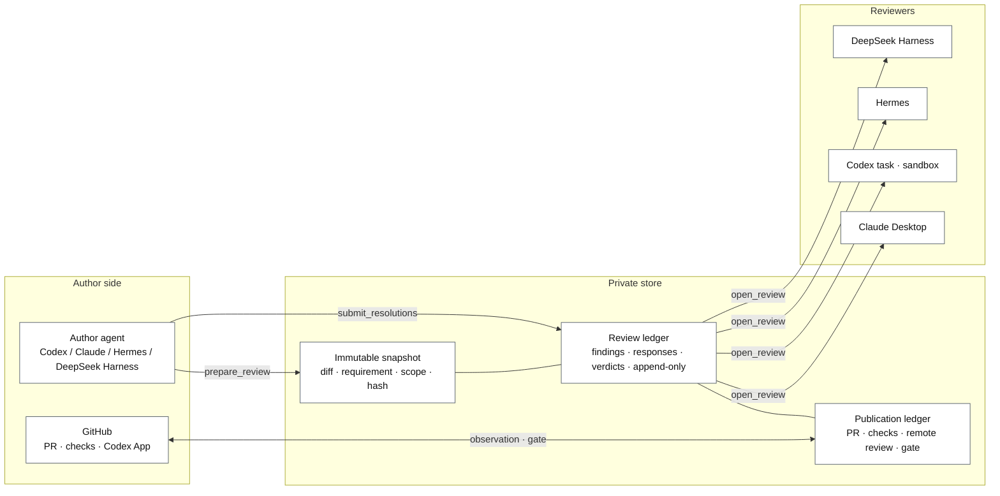
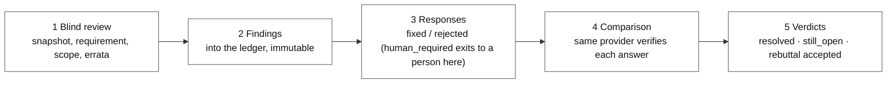
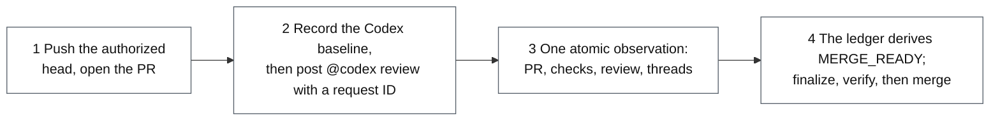

# Review Bridge: product overview

[中文版](overview.zh.md)

Review Bridge is a code-review handoff for changes written by AI agents. It
freezes a change into an **immutable snapshot**, hands it to a **reviewer that
had no part in writing it**, writes every finding, every author response, and
every verdict into an **append-only ledger**, and only lets a **publication
gate** read `MERGE_READY` once the pull request, its CI checks, and the remote
review are bound to one head. Nothing starts without an operator instruction,
and merging stays a human decision.

It runs on macOS 13 or newer and Linux with Node.js 18 or newer, as an MCP
server with two roles: the author and the reviewer are two processes with two
tool sets. Codex, Claude, Hermes, and DeepSeek Harness can each act as author
or reviewer; the Codex GitHub App provides the remote review. Installation and
upgrades are in the [README](../README.md) and under [install/](install/);
every tool and error code is in [reference.md](reference.md). This page says
what the product does and why; the pages it links to say how.

## 1. The problem

AI-written code needs review before it merges, but "it was reviewed" becomes
false easily, usually by accident:

- the code keeps changing while the review happens, so the verdict describes
  something other than what ships;
- the model that wrote the code reviews its own work in the same conversation,
  follows its own reasoning, inherits its own blind spots, and says it is fine;
- a reviewer says "CI was green" without having looked, or having looked at a
  state that is minutes stale;
- the author says "fixed", the reviewer believes it, and at merge time nothing
  on record proves the review covered the bytes being merged.

Review Bridge's answer is one sentence: **every step leaves evidence a machine
can check.** Who reviewed, exactly which bytes, what CI said at the time, all
of it is recorded, and later steps refuse to proceed when the record does not
hold up.

## 2. Design principles

Three principles run through the whole design. Each is carried by the tools
themselves as far as the tools reach: a `CODEX_TASK` reviewer is launched by
the server as a separate process, while for a reviewer dispatched by hand the
server checks the bound provider and keeping that context separate from the
author is an operator rule.

| Principle | Meaning |
| --- | --- |
| Immutable snapshot | What is reviewed is a frozen change: diff, requirement, implementation scope, with a hash. Later edits never change the version that was reviewed, and the local gate re-checks the working tree against the snapshot before it closes. |
| Isolated reviewer | The reviewer is a separate context that did not write the code. It receives the snapshot, the requirement, and the scope; the author's responses and design rationale reach it only after it has delivered its own findings, and they are material to verify, never instructions. The reviewer role has no tool that edits the repository, pushes, or opens pull requests. |
| Append-only ledger | A finding cannot be rewritten once submitted; round two appends its decisions and any new findings; publication records are revisioned, and the gate's finalization and verification events and the autonomous workflow's action trail are hash-chained. The driver proposes, the ledger decides what counts. |

One more bias shapes how the project evolves: **prefer subtraction, and prove
a state is reachable before defending it.** The state space only shrinks, and
no format is added for a one-off observation.

## 3. Architecture



Every participant on one machine shares one private store (by default
`~/Library/Application Support/ReviewBridge`, overridable with
`REVIEW_BRIDGE_HOME`): a directory of files, no database and no service
process. Its core records are the snapshots, the review ledger, and the
publication ledger; the autonomous workflow keeps its own ledgers beside
them. Concurrent processes coordinate through file locks.

The author role and the reviewer role are two server processes with two tool
sets. The reviewer can list pending reviews, open one, read and search the
snapshot, and submit findings and rereview decisions, and nothing else. The
MCP server holds no GitHub credentials; GitHub is read by a packaged
collector through the user's own `gh`, and written by the author agent's own
`gh` and `git`.

## 4. Local review



The author states the requirement, the implementation scope, the base ref,
and a reviewer choice; `prepare_review` captures the snapshot and creates the
ledger. A `CODEX_TASK` reviewer is launched by the server as a separate
process with the model and reasoning effort the operator chose; the other
providers are dispatched by the operator as their install pages describe.

In round one the reviewer sees the snapshot, the requirement, and the scope
(plus any errata the author appended, which correct claims about the world,
never the diff) and submits structured findings. No findings means `CLEAN`.
Otherwise the author answers each finding with exactly one disposition:
`fixed` (every location and every clause the finding names is done at the
new head), `rejected` (with a rationale and evidence for the rereviewer to
judge), or `human_required` (hand it to a person). Round two is the same
reviewer provider checking each answer against the new snapshot: `resolved`,
`rebuttal_accepted`, or `still_open`, with new findings allowed. There is no
third round for the same review ID.

```text
WAITING_FOR_REVIEW
  ├─ no findings ──────────────────────────────> CLEAN
  └─ findings -> REVIEW_SUBMITTED
                   ├─ human_required ──────────> HUMAN_REQUIRED
                   └─ fixed / rejected -> AUTHOR_RESPONDED
                                           -> WAITING_FOR_REREVIEW
                                                ├─ all accepted, no new -> CLEAN
                                                ├─ fix judged incomplete, or only new -> CONTINUABLE_FINDINGS
                                                └─ rebuttal still open -> HUMAN_REQUIRED

CLEAN -> working tree re-checked against the snapshot -> LOCAL_GATE_PASSED
```

Three exits. `CLEAN` becomes `LOCAL_GATE_PASSED` once the working tree is
re-checked against the snapshot; this gate attests snapshot consistency, not
test results. `CONTINUABLE_FINDINGS` means a fix was judged incomplete or a
new issue appeared with no disputed rebuttal: the author commits a new head
and opens a fresh review that carries the unfinished findings in as scope
hints. `HUMAN_REQUIRED` is reserved for a direct escalation or a rebuttal the
rereviewer still disagrees with; an arbitration packet can be exported for a
person without touching the ledger. This routing came from ledger data: most
reviews that had reached `HUMAN_REQUIRED` were followed within minutes by a
new review on the same repository and base, so "fixed but incomplete" was
made to mean "keep going".

Two things the reviewer may be given with the change. **Rule kinds**: a
finding that violates a project rule says whether the rule was already
written in the repository's agent guidance (`documented`, with its source) or
not (`undocumented`); fixing an undocumented one includes writing the rule
down. **Rationale**: the author may record its key design decisions, dropped
alternatives, and doubts before any finding exists; the reviewer sees it only
after the author has answered round one, as one more thing to verify.

A later commit on the same branch can continue a previous
`LOCAL_GATE_PASSED` review as a **successor**, where the reviewed unit is the
parent-to-child delta plus whatever it touches. It is described in
[local-review.md](local-review.md), with every provider's dispatch in
[reviewer-configuration.md](reviewer-configuration.md).

## 5. The publication gate



Publishing to GitHub needs an explicit authorization: `LOCAL_GATE`, a passed
local review, or `REMOTE_ONLY`, the operator's recorded acknowledgement that
local review is skipped. The publication ledger is bound to one head; a new
commit invalidates it, so a Codex finding means a fix commit, a new head, a
new ledger, and a new request.

The sequence: record a **baseline** of the Codex feeds (anything that existed
before the request is never an answer), post the server-composed review
request with its server-issued request ID, then let the packaged read-only
collector read the pull request, its checks, the Codex feeds, and the review
threads in one pass and hand the observation to the ledger. The adapter fails
closed: a reaction, silence, an unbound request, incomplete pagination, or an
ambiguous result never counts as a pass. `MERGE_READY` means the pull request
head equals the authorized head, the Codex result correlated to this request
is clean, every required check passed, no review thread is unresolved, and
the pull request is out of draft and mergeable. Finalizing then mints a gate
that expires within minutes; verification must succeed immediately before
the merge, and the merge is pinned to the verified head. The rules in full
are in [publication-gate.md](publication-gate.md).

## 6. The autonomous workflow

`start_autonomous_workflow` binds the repository, base, requirement, branch,
and publication target into a workflow ledger; the author-side driver then
follows the ledger's `next_action` along RFC 0003's path: commit a clean head
→ bind a Codex review → local rounds → local gate → push the gated head →
draft pull request → publication ledger → observe → mark ready → record the
terminal `MERGE_READY` and **stop**. It does not merge.

Every external action except the Codex review request comment is recorded
in a hash-chained action audit before and after it happens, so a driver that
crashes resumes from the ledger without duplicating a comment or a push; the
request comment is posted first and then bound, and a crash in between shows
up as an unbound request in the next observation. An ambiguous Codex result, a merge
conflict, a pull request someone closed, or an attempt that makes no progress
pauses the run with the evidence rather than guessing. Ownership of the
branch, the remote head ref, and the pull request belongs to one workflow at
a time. Details are in [autonomous-workflow.md](autonomous-workflow.md).

## 7. Clients, installation, and upgrades

| Client | Shape |
| --- | --- |
| Codex plugin | Author tools plus the packaged reviewer skill. The reviewer is a newly created Codex process that runs unattended in the sandbox; every MCP call passes the guardian and shell escalation is hard-refused. |
| Claude Desktop extension | A `.mcpb` extension carrying only the reviewer tools, opened by a person; Claude Code can connect to the same server as an author. |
| Hermes | Separate author and reviewer profiles; the packaged configuration snippet carries `trust: full` for unattended runs. |
| DeepSeek Harness | A cordis patch installs the reviewer profile, which refuses to start when the reviewer tools cannot connect; every run is a fresh session, so rereview starts a new one. |

Each release is built from a clean clone at the release tag, every
participant is pinned to the same release, and an upgrade builds the new
runtime in a new directory and then switches each client's path. Releases
leave evidence too: a verifier reconciles the changelog against the merges
before the tag and checks the published assets afterwards. See
[install/upgrade.md](install/upgrade.md) and
[CONTRIBUTING.md](../CONTRIBUTING.md).

## 8. Reports and statistics

- **Review report.** `render_review_report` renders a review's ledger (with its
  publication ledger when one exists), or a remote-only publication's ledger
  and authorization alone, as Markdown; the packaged `review-report.mjs`
  prints a brief by default and the full rendering with `--full`. The report
  is a projection of the ledger, not evidence.
- **Scorecard.** `review-scorecard.mjs` reads one store and aggregates per
  reviewer provider: findings by severity, author dispositions crossed with
  reviewer decisions, rebuttal outcomes, rounds to `CLEAN`, continuations,
  escalations, and rule kinds. Every counting rule is stated in the report.
- **Finding search.** `review-findings.mjs` filters historical findings by
  repository, file, keyword, severity, disposition, decision, and rule kind.
  See [finding-search.md](finding-search.md).

## 9. Usage data

The table below is what the author's own store accumulated between July and
October 2026 across several repositories, grouped by reviewer provider
(source: `review-scorecard`):

| Reviewer | Reviews | Clean | Clean in round one | Human required | Continuations | Findings |
| --- | --- | --- | --- | --- | --- | --- |
| Codex task | 609 | 397 | 206 | 89 | 80 | 1024 |
| DeepSeek Harness | 204 | 74 | 15 | 17 | 51 | 530 |
| Claude Desktop | 155 | 98 | 47 | 35 | 2 | 428 |
| Hermes | 55 | 42 | 16 | 2 | 4 | 77 |

"Human required" includes 37 legacy reviews from before
`CONTINUABLE_FINDINGS` existed.

One investigation of the "human required" reviews gave two conclusions and
changed the product directly. First, the reviewers were right about nine
times in ten: of 136 findings the author called fixed and the reviewer kept
open, 74 were partial fixes and 17 made verification claims that did not hold,
caught when the rereview checked them against the new snapshot. Second, most
of those reviews were followed within minutes by a new review on the same
repository and base. So the author guide tightened the definition of
`fixed`, and the routing sends those findings to `CONTINUABLE_FINDINGS`. One
observation remains open: the Codex task rejects "fixed" claims about 19.5%
of the time while the other three providers stay under 5%; sampling suggests
Codex is usually right, and whether the others let partial fixes through
still needs sampling.

## 10. Security boundaries and data

- The local, remote-only, and publication gates are workflow attestations, not Git
  or GitHub security boundaries. Review Bridge installs no `pre-push` hook.
  Provider binding and separate Codex tasks are not authenticated human or
  model identity; a `CODEX_TASK` review improves context isolation, which is
  not the model diversity of a separate provider.
- The host sandbox bounds writes and network, not reads, so it is no isolation
  boundary for text that can steer a reviewer. The two-round "blind review" is a
  tool-surface guarantee, not a boundary against a process that reads the
  store directly.
- The store holds repository paths, requirements, patches, manifests,
  findings, operator labels and rationales, the patch of every round
  (uncommitted changes included, whatever their size), and separate copies of
  uncommitted files up to 10 MiB each. To remove one review, stop active Review Bridge
  operations and delete `reviews/<review_id>`; if the review was bound to an
  autonomous workflow, cancel that workflow and release its claims first,
  and delete its records under `workflows/<workflow_id>` separately if they
  should go too. Quit every Review Bridge process before
  deleting the whole directory. Retention and permissions are in the
  [README](../README.md#data-handling-and-cleanup).
- The selected client may send source returned by the reviewer tools to its
  model provider according to its account configuration. The MCP server
  processes open no network connection; the packaged scripts reach GitHub
  through the user's `gh`.

Version-by-version changes are in the [CHANGELOG](../CHANGELOG.md).

## Appendix A: tools

The authoritative list is [reference.md](reference.md), generated from the
source; this is an overview grouped by purpose.

**Reviewer role**: `list_pending_reviews`, `open_review`,
`read_review_artifact`, `read_snapshot_file`, `search_snapshot`,
`submit_review`, `submit_rereview`.

**Author role, by purpose:**

| Group | Tools |
| --- | --- |
| Local review | `discover_reviewer_options` `select_reviewer_configuration` `launch_local_reviewer` `prepare_review` `list_reviews` `get_review` `get_review_summary` `wait_for_review_state` `submit_resolutions` `prepare_rereview` `append_review_erratum` `finalize_local_gate` `export_human_arbitration` `render_review_report` |
| Publication gate | `authorize_remote_publication` `start_publication` `get_publication` `get_publication_summary` `record_codex_review_request` `record_github_snapshot` `acknowledge_codex_review_ambiguity` `finalize_publication_gate` `verify_publication_gate` `get_autonomous_pre_ready` `get_autonomous_terminal` |
| Autonomous workflow | `start_autonomous_workflow` `list_autonomous_workflows` `get_autonomous_workflow` `get_autonomous_workflow_summary` `record_workflow_head` `bind_workflow_review` `bind_workflow_publication` `advance_local_workflow` `advance_remote_workflow` `pause_autonomous_workflow` `resume_autonomous_workflow` `cancel_autonomous_workflow` `release_workflow_claims` `extend_change_size_budget` `acknowledge_change_size_warning` `extend_local_cycle_budget` `extend_remote_cycle_budget` |
| External action trail | `plan_codex_task_dispatch` `launch_codex_task_dispatch` `record_codex_task_observation` `plan_workflow_push` `record_push_observation` `plan_draft_pull_request` `record_draft_pull_request_observation` `plan_mark_pull_request_ready` `record_mark_ready_observation` `plan_return_to_draft` `record_return_to_draft_observation` `mark_workflow_action_executing` `complete_workflow_action` `abandon_workflow_action` |
| Thread handling | `get_thread_resolution_plan` `get_invalidated_resolution_plan` `plan_thread_reply` `record_thread_reply_observation` `plan_thread_resolution` `record_thread_resolution_observation` `record_automatic_resolution` `plan_thread_unresolve` `record_thread_unresolve_observation` `record_automatic_unresolve` |

## Appendix B: glossary

| Term | Meaning |
| --- | --- |
| snapshot | The change frozen for one review round, identified by a hash. |
| ledger | The server-side record, append-only; the driver proposes, the ledger decides what counts. |
| finding | One structured reviewer comment: severity, title, explanation, and usually a location and recommendation. |
| resolution | The author's answer to a finding: fixed, rejected, or human_required, with a rationale. |
| rationale | The author's design account, written before review and served only after the author has answered. |
| successor | A review that continues a previous gated review; the reviewed unit is the delta. |
| continuation | A fresh full review opened from `CONTINUABLE_FINDINGS`, carrying the unfinished findings as scope hints. |
| baseline | The state of the Codex feeds before a request; earlier comments are never an answer. |
| observation | The collector's one-pass reading of the pull request, checks, Codex feeds, and threads. |
| gate | The record a finalize step writes; the publication gate expires and is verified immediately before a merge. |
