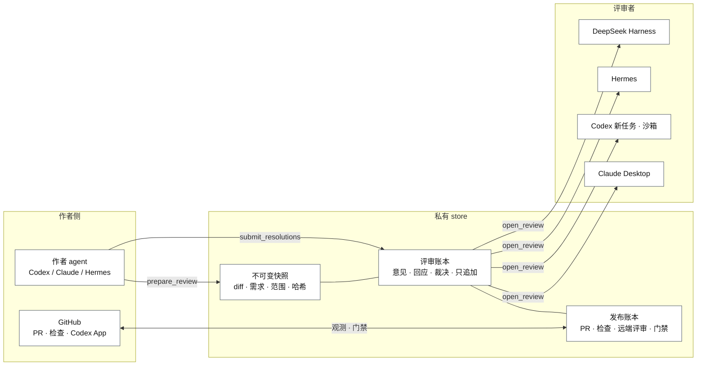
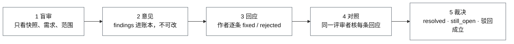
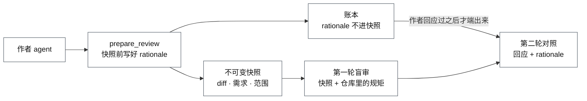
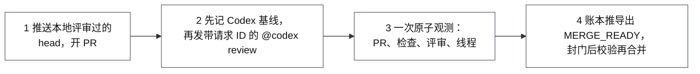

# Review Bridge 产品说明

[English](overview.md)

Review Bridge 是一个代码评审交接工具，服务于由 AI agent 写代码的场景。它把一次改动冻结成**不可变快照**，交给一个**没参与写代码的评审者**，把每条意见、每次回应、每个裁决写进**只追加的账本**，再由一道**发布门禁**把 PR、CI 检查和远端评审绑到同一个 head 之后才给出 `MERGE_READY`。任何一步都不会在没有操作者指令时自己启动，合并始终是人的决定。

支持 macOS 13 以上和 Linux，Node.js 18 以上。它以 MCP 服务器的形式运行，作者和评审者是两个角色、两个进程、两套工具；Codex、Claude、Hermes、DeepSeek Harness 都可以作为作者或评审者接入，GitHub 上的 Codex App 则承担远端评审。安装与升级见 [README](../README.md) 和 [install/](install/)；每个工具和错误码见 [reference.md](reference.md)。

## 1. 要解决的问题

AI 写的代码在合并前需要评审，但「审过了」这件事很容易在无意间变成假的：

- 评审进行的时候代码还在改，裁决描述的不是最终合并的那个版本；
- 写代码的模型在同一个会话里审自己的代码，顺着自己的推理验证，继承自己的盲区，然后说「没问题」；
- 评审者说「CI 是绿的」，但其实没有看，或者看的是几分钟前的旧状态；
- 作者说「修了」，评审者就信了，合并那一刻没有任何记录能证明评审覆盖了被合并的字节。

Review Bridge 的回答是一句话：**每一步都留下机器可以核的证据。**谁审的、审的是哪些字节、当时 CI 怎么说，全部记录；后面的步骤在记录对不上时拒绝前进。

## 2. 设计原则

三条原则贯穿全部设计。它们都是机制而不是纪律：靠 skill 约定「先别读作者的说法」是可以被跳过的，工具根本不给就跳不过。

| 原则 | 含义 | 靠什么保证 |
| --- | --- | --- |
| 不可变快照 | 评审的是一个冻结的改动：diff、需求、实现范围，带哈希。作者之后再改，审过的那个版本不会变。 | 快照哈希进账本；本地门禁封门前再核一次工作树仍等于快照。 |
| 隔离的评审者 | 评审者是一个没参与写代码的新上下文。作者的回应、设计理由、勘误都是待核的材料，不是指令。 | 第一轮 `open_review` 不返回任何作者材料；评审者角色没有改仓库、推代码、开 PR 的工具。 |
| 只追加的账本 | 意见提交后不能改；第二轮只能追加裁决；每次变更带期望修订号。 | 服务器端状态机、修订号校验、哈希链审计日志。 |

另有一条取向贯穿演进：**优先减法，先证明一个状态可达再给它加防御。**状态空间只会收缩，不会为一次性的观测添加格式。

## 3. 总体架构



所有参与者共用一个私有 store（默认 `~/Library/Application Support/ReviewBridge`，可用 `REVIEW_BRIDGE_HOME` 覆盖）。它是本地文件系统上的一个目录，没有数据库，没有服务进程，全部是 JSON 和 patch 文件，目录 0700、文件 0600。里面有三类记录：

- **快照**：每轮评审一个目录，含完整 patch、按文件的字节范围索引、变更文件副本、manifest 和哈希。超过 10 MiB 的文件只记录不复制。
- **评审账本**（`review.json`）：需求、范围、rationale、每轮快照身份、findings、作者回应、复审裁决、勘误、历史事件。
- **发布账本**：授权、Codex 基线、请求与结果的关联、GitHub 观测、门禁与审计链。

「共用」指同一台机器上作者和评审者的几个 MCP 进程指向同一个目录，不是网络共享。并发靠文件锁，写入是先写临时文件再原子重命名，每次变更带期望修订号。

作者角色和评审者角色是两个服务器进程、两套工具。评审者只能列出待审任务、打开任务、读快照和 patch、搜索快照、提交意见与复审裁决；它看不到发布工具和作者工具，所以一个面板审第三方 PR 永远铸不出门禁。MCP 服务器本身不持有 GitHub 凭据，也没有任何网络客户端或遥测；对 GitHub 的读写由打包的脚本通过用户自己配置的 `gh` 完成。

## 4. 本地评审

### 4.1 准备与派发

作者在自己的会话里发起：说明需求、实现范围、base ref，选择评审者。作者侧依次调用 `discover_reviewer_options`（查询目标运行时可见的模型与推理强度）、`prepare_review`（截快照、建账本）、`select_reviewer_configuration`（记录明确选择的模型与强度）、`launch_local_reviewer`（拉起一个独立的 Codex 进程）。作者会话的模型不替用户选评审者；无人值守的驱动必须预先授权一对配置，否则停下而不是等待。

快照在派发前按「新增加删除行数」计量。自治工作流在达到预算的 75% 时报告余量，超过默认 2000 行时暂停等操作者决定拆不拆；手动评审只报数不拦。

也可以手动派发：新开一个 Codex 任务（不是作者任务的分支）、一个新的 Claude Desktop 对话、或一个独立的 Hermes / DeepSeek Harness profile，只给它评审请求和 `review_id`。细节见 [local-review.md](local-review.md) 和 [reviewer-configuration.md](reviewer-configuration.md)。

### 4.2 两轮评审



第一轮评审者只拿到快照、需求和范围，提交结构化的 findings（严重度、位置、解释、建议）。没有意见直接 `CLEAN`。有意见则作者逐条回应，每条只能选一种：

- `fixed`：finding 点名的**每个位置、每个子句**在新 head 都做完了，包括它要求的测试或文档。采用与建议不同的方案不是 fixed。
- `rejected`：给出具体的技术证据，由复审者判驳回是否成立；判成立的复审者要附可重放的验证。
- `human_required`：直接停下交人仲裁。

第二轮由同一评审者（Codex 新任务和 DeepSeek Harness 不续用进程，会新开一个）对照新快照逐条裁决：`resolved`、`rebuttal_accepted`、`still_open`，也可以报新意见。同一个 review ID 没有第三轮。

### 4.3 规矩分类与设计理由



**规矩分类。**评审发现的问题里有一类是「违反了项目规矩」。评审者先在快照里搜仓库的 agent 指导文件（`AGENTS.md`、`.agents/`、`CLAUDE.md`、invariants 文件等）：规矩写了，finding 标 `constraint: {kind: "documented", source: <文件>}`；没写，标 `{kind: "undocumented"}`；不是规矩类的不标。修一条 undocumented 的意见，包括在同一个 PR 里把规矩写进仓库的指导文件，复审者会核。scorecard 据此统计两类各多少，以及未写入仓库的规矩所占比例。

**设计理由。**`prepare_review` 可以附一段 `rationale`：关键设计决策、放弃的方案及原因、有意固定的部分、自己没把握的地方。它由作者 agent 在任何意见出现之前写下，只写事实性的取舍，不写论证；它不进快照，第一轮评审者看不到，作者回应过第一轮意见之后 `open_review` 才带上。评审者先重读自己第一轮的 findings，再拿 rationale 对照第一轮快照，它和其它作者材料一样只是待核的材料。

### 4.4 三个出口与状态机

```text
WAITING_FOR_REVIEW
  ├─ 没有意见 ─────────────────────────────> CLEAN
  └─ 有意见 -> REVIEW_SUBMITTED
                ├─ human_required ─────────> HUMAN_REQUIRED
                └─ fixed / rejected -> AUTHOR_RESPONDED
                                        -> WAITING_FOR_REREVIEW
                                             ├─ 全部接受，无新意见 -> CLEAN
                                             ├─ 修复不完整，或只有新意见 -> CONTINUABLE_FINDINGS
                                             └─ 驳回仍 still_open -> HUMAN_REQUIRED

CLEAN -> 再核工作树等于快照 -> LOCAL_GATE_PASSED
```

- `CLEAN` → `LOCAL_GATE_PASSED`：所有意见都接受。`finalize_local_gate` 再核一次工作树等于快照。这道门禁证明的是快照一致性，不是测试结果；测试由发布阶段的 CI 证据把关。
- `CONTINUABLE_FINDINGS`：没有争议的驳回，但第二轮判某条修复不完整，或发现了新问题。作者提交新 head，用 `continued_from_review_id` 开一条新的全量评审，未完的意见原样携带进去作为范围提示，不带双方的理由。
- `HUMAN_REQUIRED`：作者驳回而复审者仍不认，真争议才交给人。`export_human_arbitration` 导出一份确定性的仲裁包（需求、范围、rationale、各轮快照身份、意见与双方说法），导出不改账本、不消耗轮次。

这个路由是根据账本数据改的：曾进入 HUMAN_REQUIRED 的评审里，仲裁导出一次都没被调用过，绝大多数在十几分钟内于同仓库同 base 重开了新评审，争议意见在新评审里几乎不再出现。也就是说「修了但没修完」在实践里的含义是继续，不是仲裁，状态名应该说实话。

### 4.5 继承评审与阅读索引

同一分支上的后续提交可以继承上一条 `LOCAL_GATE_PASSED` 的评审：服务器自动寻找父任务（同仓库、同 base、已门禁的 head 是当前 head 的严格祖先），生成 `successor.json` 和精确的父到子 delta，评审者只读 delta 及相关调用方、契约和测试，仅在 delta 改了对外契约、触及安全或兼容面、或证明无法核实时展开全量 patch。任何前置条件不成立就记录为 `FULL` 回退。

全量 patch 是累计的 base 到 head diff。`open_review` 随快照返回 `patch_index`：每个文件在 `patch.diff` 里的字节偏移和长度，评审者按需读取并报告跳过了什么。索引从不存储，每次按同一份不可变 patch 现算，并先核对 patch 仍等于本轮提交的快照哈希，所以索引不可能与实际字节不一致。

### 4.6 顾问面板

审别人的 PR 时可以组一个顾问面板：打包脚本把 PR 克隆到任何写作目录之外，每位成员各自 `prepare_review` 并带 `advisory: true`。顾问评审只接受 `submit_review`，门禁、回应、复审、勘误全部拒绝，所以它只能产出报告，永远不能给操作者没写的代码铸门禁。Codex 成员在 Linux 容器里跑，容器就是读边界：只挂载只读的凭据、只读的插件、只读的克隆和这一条评审的副本，不挂载宿主 store，出口只放行 OpenAI 的三个域名，裁决通过宿主的 `submit_review` 重放且必须和容器内账本一致才保留。

## 5. 发布门禁



发布到 GitHub 需要一次明确授权，两种模式：`LOCAL_GATE` 以通过的本地评审为授权，是默认；`REMOTE_ONLY` 仅当操作者直接选择跳过本地评审时可用，`authorize_remote_publication` 记录 `LOCAL_REVIEW_SKIPPED` 确认、操作者标签、理由、干净的本地仓库和 base / head。无论哪种，作者工具都把授权、PR、必需检查、带服务器签发请求 ID 的 Codex 请求、钉死的 Codex Bot actor、结果和评审线程绑到**一个 head**。

流程：先记一份 Codex 三个 feed 的**基线**（请求之前就存在的评论不算答复），再原样发出服务器组好的 `@codex review` 评论并立即绑定；之后打包的只读收集器用 `gh` 一次性读取 PR、分支策略、检查运行、提交状态、三个 Codex feed 和评审线程，写成观测交给 `record_github_snapshot`，账本从观测推导状态。要点：

- **原子读。**分页的读取不描述同一时刻，所以检查运行、提交状态、线程这类单值决定去留的资源各用一次请求读完，出现第二页就让收集失败。
- **fail-closed 适配器。**孤立的评论、表情、沉默、未绑定的请求、分页不完整、歧义结果，全部判失败而不是通过。Codex 的回复靠请求 ID 关联，没带 ID 时只接受唯一一条无前驱的开放请求并核对所评审的 commit。
- **`MERGE_READY` 四条件。**PR 的 head 等于授权的 head；关联到本次请求的 Codex 结果是干净的；所有必需检查通过；没有未 resolve 的评审线程。
- **门票会过期。**`finalize_publication_gate` 签发一张门票，有效期是观测里最早一次采集之后五分钟；`verify_publication_gate` 必须在合并前立刻返回 `valid: true`。新 commit 让账本失效；Codex 发了意见就得修、推新 head、新开账本重新请求。

观测和账本都不经过模型的上下文：收集器把观测写在账本旁边，只打印回执；重打一遍几万 token 既花钱又多一个抄错的失败模式。细节见 [publication-gate.md](publication-gate.md)。

## 6. 自治工作流

`start_autonomous_workflow` 把仓库、base、需求、分支、发布目标、能力集和授权摘要绑成一个工作流账本，然后沿 RFC 0003 的路径自动走完：提交干净 head → 绑定 Codex 评审 → 本地两轮 → 本地门禁 → 快进推送门禁过的 head → 开草稿 PR → 发布账本 → 观察 → 标记 ready → 记录终态 `MERGE_READY` 然后**停下**。它不合并。

每个对外动作（派发评审、推送、建 PR、回复线程、resolve 线程、切换草稿状态）都走同样的四步：记录意图 → 再看一眼再动手 → 对照结果 → 记录完成，写进哈希链的动作审计。驱动模型随时可能崩溃，重启后读账本就知道停在哪一步：停在第一步什么都没发生，停在第二步就去对照提供方而不是重放，这就是不会重复评论、不会重复推送的原因。「再看一眼」还会抓住计划与执行之间世界的变化：CI 在这期间红了，动作就拒绝执行。

其它规则：PR 一旦离开草稿就不再推新 commit，要改先回草稿，三处分别拦；线程先回复再 resolve，回复要出现在观测里才允许关；Codex 结果歧义、合并冲突、PR 被人关掉，一律暂停并附证据，不猜；重复出现同样 blocker 和同样 head 的尝试判 `NO_PROGRESS` 暂停。store 范围内对本地分支、远端 head ref 和 PR 的所有权一次只给一个活跃或暂停的工作流。细节见 [autonomous-workflow.md](autonomous-workflow.md)。

## 7. 客户端、安装与升级

| 客户端 | 形态 |
| --- | --- |
| Codex 插件 | 作者工具加打包的评审者 skill。评审者是一个新建的 Codex 进程，在沙箱里无人值守跑，MCP 调用经 guardian 逐条审批，shell 提权硬拒。 |
| Claude Desktop 扩展 | 只装评审者工具的 `.mcpb` 扩展，只能由人手开；Claude Code 可以作为作者连接同一个服务器。 |
| Hermes | 作者与评审者两个 profile，打包的配置片段带 `trust: full`，可无人值守。 |
| DeepSeek Harness | cordis patch 装评审者 profile，连不上评审工具就不启动；每次都是新 session，复审会新开一个。 |

每个版本从 release tag 的干净 clone 构建：`npm ci && npm run build && npm run verify:build`，产物包含 Codex marketplace、Claude 扩展源码、Hermes 与 DeepSeek 的集成目录，以及 `.mcpb` / `.dxt` / 源码包和 SHA256SUMS。所有参与者钉在同一个发布版本上。升级是在新目录构建新运行时，然后逐个切换客户端的路径：Codex marketplace 同名换源要先 remove 再 add；Hermes 和 DeepSeek 的 reviewer skill 若在版本间改过，要拷新文件而不只是改路径。见 [install/upgrade.md](install/upgrade.md)。

发版本身也留证据：`verify-release --pre` 在打 tag 前核对 changelog 的 PR 认领与范围内的合并双向对账（支持 merge commit 和 squash 两种历史），`--final` 在发布后对照 GitHub 的事实与资产哈希，通过后把发布记录写进 store。

## 8. 报告与统计

- **评审报告。**`render_review_report` 把一条评审的账本（有发布账本则一并）渲染成 Markdown 写在账本旁；打包的 `review-report.mjs` 默认打印摘要（终态、下一步、事实表、仍开放的意见、各轮事实），`--full` 打印全文。报告是账本的投影，不是证据，不动账本、不消耗轮次。
- **scorecard。**`review-scorecard.mjs` 只读 store，按评审者提供方汇总：各严重度意见数、作者回应与复审裁决的交叉、驳回在验证义务前后的成立率、到 CLEAN 的轮数、继续评审、工作流预算事件、仲裁升级、规矩分类。每条计数规则写在报告里，可以对着账本重放。支持按时间、仓库、门禁/顾问类型、FULL/SUCCESSOR 策略过滤。
- **历史意见检索。**`review-findings.mjs` 按仓库、文件、关键词、严重度、作者回应、复审裁决、规矩分类过滤，保留每条意见的原始快照和账本位置。见 [finding-search.md](finding-search.md)。

## 9. 运行数据

下面是作者自己的 store 在 2026 年 7 月到 10 月之间积累的数据，覆盖多个仓库，按评审者提供方汇总（来源：review-scorecard）：

| 评审者 | 评审数 | 干净 | 第一轮即干净 | 需要人 | 继续评审 | 意见数 |
| --- | --- | --- | --- | --- | --- | --- |
| Codex 新任务 | 609 | 397 | 206 | 89 | 80 | 1024 |
| DeepSeek Harness | 204 | 74 | 15 | 17 | 51 | 530 |
| Claude Desktop | 155 | 98 | 47 | 35 | 2 | 428 |
| Hermes | 55 | 42 | 16 | 2 | 4 | 77 |

「需要人」含 `CONTINUABLE_FINDINGS` 落地前的 37 条历史遗留。

对「需要人」的一次调查给了两条结论，并直接改了产品：第一，评审者九成有理，136 条「作者说修了、评审者说没修」里 74 条是只修了一部分，17 条是作者声称的验证不属实，由盲审核出；第二，操作者从不导出仲裁包，而是立刻重开评审。于是作者指导里收紧了 `fixed` 的定义，路由上把这类意见改走 `CONTINUABLE_FINDINGS`。另一个未定的观察：Codex 复审驳回「已修」的比例约 19.5%，其它三家都在 5% 以下，抽样看 Codex 多半有理；其它三家是否放过了没修完的修复，还需要抽样核实。

## 10. 安全边界与数据

- 本地、远端和发布门禁是工作流层面的证明，不是 Git 或 GitHub 的安全边界。Review Bridge 不装 `pre-push` 钩子。提供方绑定和独立的 Codex 任务不是经过认证的人或模型身份；`CODEX_TASK` 评审改善的是上下文隔离，不等于换一家模型的多样性。
- 宿主沙箱限制写和网络，不限制读；审第三方代码时的读边界由容器提供（第 4.6 节）。本地两轮评审的「盲审」是工具面上的保证：评审工具在作者回应之前不端出作者材料；它不是对一个能直接读 store 的进程的边界。
- store 里有仓库路径、需求、patch、manifest、意见、远端授权的操作者标签与理由，以及变更文件的副本，目录 0700、文件 0600。删除一条评审就删 `reviews/<review_id>`；删全部就删整个目录。
- 所选客户端可能按其账号配置把评审工具返回的源码发给模型提供方；Review Bridge 自身不含网络客户端。

版本变化见 [CHANGELOG.md](../CHANGELOG.md)。

## 附录 A · 工具清单

权威列表是由源码生成的 [reference.md](reference.md)；这里按功能分组给一个总览。

**评审者角色**：`list_pending_reviews`、`open_review`、`read_review_artifact`、`read_snapshot_file`、`search_snapshot`、`submit_review`、`submit_rereview`。

**作者角色，按功能分组：**

| 分组 | 工具 |
| --- | --- |
| 本地评审 | `discover_reviewer_options` `select_reviewer_configuration` `launch_local_reviewer` `prepare_review` `list_reviews` `get_review` `get_review_summary` `wait_for_review_state` `submit_resolutions` `prepare_rereview` `append_review_erratum` `finalize_local_gate` `export_human_arbitration` `render_review_report` |
| 发布门禁 | `authorize_remote_publication` `start_publication` `get_publication` `get_publication_summary` `record_codex_review_request` `record_github_snapshot` `acknowledge_codex_review_ambiguity` `finalize_publication_gate` `verify_publication_gate` `get_autonomous_pre_ready` `get_autonomous_terminal` |
| 自治工作流 | `start_autonomous_workflow` `list_autonomous_workflows` `get_autonomous_workflow` `get_autonomous_workflow_summary` `record_workflow_head` `bind_workflow_review` `bind_workflow_publication` `advance_local_workflow` `advance_remote_workflow` `pause_autonomous_workflow` `resume_autonomous_workflow` `cancel_autonomous_workflow` `release_workflow_claims` `extend_change_size_budget` `acknowledge_change_size_warning` `extend_local_cycle_budget` `extend_remote_cycle_budget` |
| 对外动作轨迹 | `plan_codex_task_dispatch` `launch_codex_task_dispatch` `record_codex_task_observation` `plan_workflow_push` `record_push_observation` `plan_draft_pull_request` `record_draft_pull_request_observation` `plan_mark_pull_request_ready` `record_mark_ready_observation` `plan_return_to_draft` `record_return_to_draft_observation` `mark_workflow_action_executing` `complete_workflow_action` `abandon_workflow_action` |
| 线程处理 | `get_thread_resolution_plan` `get_invalidated_resolution_plan` `plan_thread_reply` `record_thread_reply_observation` `plan_thread_resolution` `record_thread_resolution_observation` `record_automatic_resolution` `plan_thread_unresolve` `record_thread_unresolve_observation` `record_automatic_unresolve` |

## 附录 B · 术语

| 术语 | 含义 |
| --- | --- |
| 快照 snapshot | 一轮评审所冻结的改动：patch、变更文件副本、manifest、哈希。 |
| 账本 ledger | 服务器端的记录，只追加；驱动提议，账本决定什么算数。 |
| finding | 评审者提交的一条结构化意见：严重度、位置、解释、建议，可选规矩分类。 |
| resolution | 作者对一条意见的回应：fixed / rejected / human_required，附理由与证据。 |
| rationale | 作者在评审前写下的设计理由，第二轮才给评审者。 |
| successor | 继承上一条已门禁评审的任务，评审单位是 delta。 |
| 继续评审 continuation | 从 CONTINUABLE_FINDINGS 开的新全量评审，携带未完意见作为范围提示。 |
| 基线 baseline | 发起 Codex 请求前三个 feed 的完整快照，请求之前存在的评论不算答复。 |
| 观测 observation | 收集器一次性读取的 PR、检查、Codex feed、线程状态。 |
| 门票 gate | finalize 签发、几分钟内有效、合并前必须校验的凭据。 |
| 顾问评审 advisory | 只产出报告、不能铸门禁的评审，用于审他人的 PR。 |
