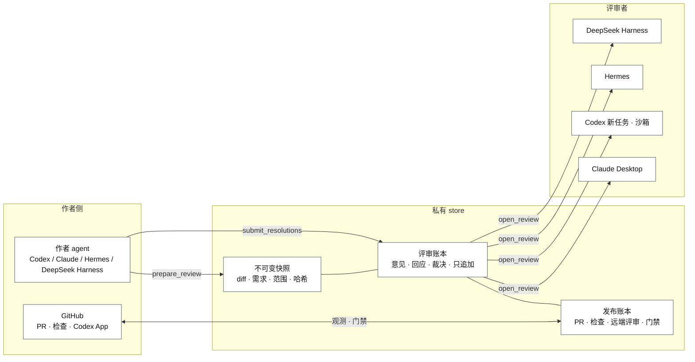
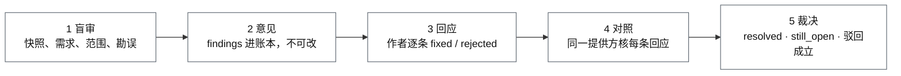
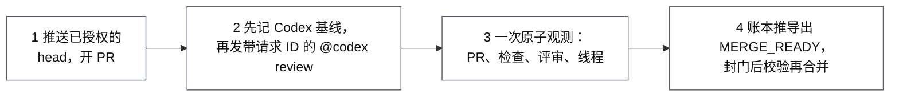

# Review Bridge 产品说明

[English](overview.md)

Review Bridge 是一个代码评审交接工具，服务于由 AI agent 写代码的场景。它把一次改动冻结成**不可变快照**，交给一个**没参与写代码的评审者**，把每条意见、每次回应、每个裁决写进**只追加的账本**，再由一道**发布门禁**把 PR、CI 检查和远端评审绑到同一个 head 之后才给出 `MERGE_READY`。任何一步都要有操作者的指令才会开始，合并始终是人的决定。

它运行在 macOS 13+ 或 Linux、Node.js 18+ 上，是一个有两个角色的 MCP 服务器：作者和评审者是两个进程、两套工具。Codex、Claude、Hermes、DeepSeek Harness 都可以当作者或评审者；远端评审由 Codex GitHub App 提供。安装与升级见 [README](../README.md) 和 [install/](install/)；每个工具和错误码见 [reference.md](reference.md)。本页讲产品做什么、为什么这样做；怎么做的细节在它链接到的各专题页。

## 1. 要解决的问题

AI 写的代码在合并前需要评审，但「已经评审过了」这句话很容易在不知不觉中变成假话：

- 评审进行的时候代码还在改，裁决描述的是另一个版本；
- 写代码的模型在同一个会话里审自己的代码，顺着自己的思路走，继承自己的盲点，然后说没问题；
- 评审者说「CI 是绿的」，其实没看，或者看的是几分钟前的状态；
- 作者说「修了」，评审者信了，到合并时没有任何记录能证明评审覆盖的就是要合并的那些字节。

Review Bridge 的回答只有一句话：**每一步都留下机器能核的证据。**谁审的、审的是哪些字节、当时 CI 怎么说，全部记录在案，后面的步骤在记录对不上时拒绝继续。

## 2. 设计原则

三条原则贯穿整个设计。每一条都由工具本身承担，而不是靠参与者遵守的规矩。

| 原则 | 含义 |
| --- | --- |
| 不可变快照 | 评审的是一个冻结的改动：diff、需求、实现范围，带哈希。作者之后再改，审过的那个版本不会变；本地门禁封门前会再核一次工作树等于快照。 |
| 隔离的评审者 | 评审者是一个没参与写代码的独立上下文。它拿到快照、需求和范围；作者的回应和设计理由要等它交出自己的意见之后才给它，而且是待核的材料，不是指令。评审者角色没有改仓库、推代码、开 PR 的工具。 |
| 只追加的账本 | 意见提交后不能改；第二轮只能追加裁决；发布和工作流的记录带修订号并有审计链。驱动提议，账本裁定。 |

还有一个贯穿项目演进的偏好：**优先做减法，先证明一个状态可达再为它写防御。**状态空间只缩不扩，不为一次性的观察新增格式。

## 3. 总体架构



同一台机器上的所有参与者共用一个私有 store（默认 `~/Library/Application Support/ReviewBridge`，可用 `REVIEW_BRIDGE_HOME` 覆盖）：一个文件目录，没有数据库，没有服务进程。核心记录是快照、评审账本和发布账本；自治工作流的账本放在它们旁边。并发进程靠文件锁协调。

作者角色和评审者角色是两个服务器进程、两套工具。评审者只能列出待审任务、打开任务、读和搜索快照、提交意见与复审裁决，别的都做不了。MCP 服务器不持有 GitHub 凭据；读 GitHub 由打包的收集器通过用户自己的 `gh` 完成，写 GitHub 是作者 agent 自己的 `gh` 和 `git`。

## 4. 本地评审



作者说明需求、实现范围、base ref，选择评审者；`prepare_review` 截快照、建账本。`CODEX_TASK` 评审者由服务端按操作者选定的模型和推理强度另起一个进程；其它提供方由操作者按各自安装页的说明派发。

第一轮评审者看到快照、需求和范围（以及作者追加过的勘误，勘误只修正关于外部世界的说法，不改 diff），提交结构化的 findings。没有意见直接 `CLEAN`。有意见则作者逐条回应，每条只能选一种：`fixed`（finding 点名的每个位置、每个子句在新 head 都做完了）、`rejected`（给出理由和证据，由复审者判）、`human_required`（交给人）。第二轮由同一评审者提供方对照新快照核每条回应：`resolved`、`rebuttal_accepted`、`still_open`，也可以报新意见。同一个 review ID 没有第三轮。

```text
WAITING_FOR_REVIEW
  ├─ 没有意见 ─────────────────────────────> CLEAN
  └─ 有意见 -> REVIEW_SUBMITTED
                ├─ human_required ─────────> HUMAN_REQUIRED
                └─ fixed / rejected -> AUTHOR_RESPONDED
                                        -> WAITING_FOR_REREVIEW
                                             ├─ 全部接受，无新意见 -> CLEAN
                                             ├─ 修复不完整，或只有新意见 -> CONTINUABLE_FINDINGS
                                             └─ 驳回仍 still_open -> HUMAN_REQUIRED

CLEAN -> 再核工作树等于快照 -> LOCAL_GATE_PASSED
```

三个出口。`CLEAN` 在再核一次工作树等于快照之后成为 `LOCAL_GATE_PASSED`；这道门禁证明的是快照一致性，不是测试结果。`CONTINUABLE_FINDINGS` 是没有争议的驳回、但某条修复被判不完整或出现了新问题：作者提交新 head，开一条新评审，未完的意见作为范围提示携带进去。`HUMAN_REQUIRED` 只留给直接升级和复审者仍不认的驳回；可以为人导出一份仲裁包，不动账本。这个路由是根据账本数据改的：曾进入 HUMAN_REQUIRED 的评审绝大多数在十几分钟内于同仓库同 base 重开了新评审，于是「修了但没修完」被改成了「继续」。

随改动一起交给评审者的还有两样。**规矩分类**：违反项目规矩的 finding 会标明这条规矩是否已写在仓库的 agent 指导文件里（`documented` 并注明出处，或 `undocumented`）；修一条 undocumented 的意见包括把规矩写下来。**设计理由**：作者可以在任何意见出现之前记下关键设计决策、放弃的方案和自己没把握的地方；评审者只在作者回应过第一轮之后才看到它，而且只当作又一份待核材料。

两个变体。同一分支上的后续提交可以作为 **successor** 继承上一条 `LOCAL_GATE_PASSED` 的评审，评审单位是父到子的 delta 及其波及之处。几个独立的评审者可以组成**顾问面板**审别人的 PR；顾问评审只能产出报告、不能铸门禁，通过打包 launcher 拉起的顾问 Codex 成员跑在容器里，容器就是读边界。两者见 [local-review.md](local-review.md)，各提供方的派发方式见 [reviewer-configuration.md](reviewer-configuration.md)。

## 5. 发布门禁



发布到 GitHub 需要一次明确授权：`LOCAL_GATE`，即通过的本地评审；或 `REMOTE_ONLY`，即操作者记录在案的「跳过本地评审」确认。发布账本绑在一个 head 上；新 commit 让它失效，所以 Codex 发了意见就得修、推新 head、新开账本、重新请求。

流程：先记一份 Codex feed 的**基线**（请求之前就存在的东西永远不算答复），再发出服务器组好的、带服务器签发请求 ID 的评审请求，然后由打包的只读收集器一次性读取 PR、检查、Codex feed 和评审线程，把观测交给账本。适配器 fail-closed：表情、沉默、未绑定的请求、分页不完整、歧义结果，都不算通过。`MERGE_READY` 的含义是：PR 的 head 等于授权的 head，关联到本次请求的 Codex 结果是干净的，所有必需检查通过，没有未 resolve 的评审线程，PR 已离开草稿且可合并。之后封门签发一张几分钟内过期的门票；合并前必须立刻校验通过，并且合并钉在校验过的 head 上。完整规则见 [publication-gate.md](publication-gate.md)。

## 6. 自治工作流

`start_autonomous_workflow` 把仓库、base、需求、分支和发布目标绑成一个工作流账本，之后由作者侧的驱动按账本的 `next_action` 沿 RFC 0003 的路径走：提交干净 head → 绑定 Codex 评审 → 本地两轮 → 本地门禁 → 推送门禁过的 head → 开草稿 PR → 发布账本 → 观察 → 标记 ready → 记录终态 `MERGE_READY` 然后**停下**。它不合并。

每个对外动作在发生前后都写进哈希链的动作审计，所以驱动崩溃后可以从账本接着走，不会重复评论、重复推送。Codex 结果歧义、合并冲突、PR 被人关掉、或者一次尝试毫无进展，都是带着证据暂停，而不是猜。分支、远端 head ref 和 PR 的所有权一次只属于一个工作流。细节见 [autonomous-workflow.md](autonomous-workflow.md)。

## 7. 客户端、安装与升级

| 客户端 | 形态 |
| --- | --- |
| Codex 插件 | 作者工具加打包的评审者 skill。评审者是新建的 Codex 进程，在沙箱里无人值守运行；每次 MCP 调用都过 guardian，shell 升权被硬拒。 |
| Claude Desktop 扩展 | 只含评审者工具的 `.mcpb` 扩展，由人打开；Claude Code 可以作为作者连同一个服务器。 |
| Hermes | 作者和评审者两个独立 profile；打包的配置片段带 `trust: full` 以支持无人值守。 |
| DeepSeek Harness | 由 cordis patch 安装评审者 profile，评审者工具连不上就拒绝启动；每次运行都是新会话，复审会新开一个。 |

每个版本从 release tag 的干净 clone 构建，所有参与者钉在同一个版本上，升级是在新目录构建新运行时再逐个切换客户端的路径。发版本身也留证据：验证脚本在打 tag 前对照 changelog 与合并记录，发布后核对已发布的资产。见 [install/upgrade.md](install/upgrade.md) 和 [CONTRIBUTING.md](../CONTRIBUTING.md)。

## 8. 报告与统计

- **评审报告。**`render_review_report` 把一条评审的账本（连同发布账本）渲染成 Markdown；打包的 `review-report.mjs` 默认打印摘要，`--full` 打印全文。报告是账本的投影，不是证据。
- **scorecard。**`review-scorecard.mjs` 只读 store，按评审者提供方汇总：各严重度意见数、作者回应与复审裁决的交叉、驳回成立率、到 CLEAN 的轮数、继续评审、升级、规矩分类。每条计数规则写在报告里。
- **意见检索。**`review-findings.mjs` 按仓库、文件、关键词、严重度、回应、裁决、规矩分类筛历史意见。见 [finding-search.md](finding-search.md)。

## 9. 运行数据

下表是作者自己的 store 在 2026 年 7 月到 10 月之间、跨若干仓库积累的数据，按评审者提供方分组（来源：`review-scorecard`）：

| 评审者 | 评审数 | 干净 | 第一轮即干净 | 需要人 | 继续评审 | 意见数 |
| --- | --- | --- | --- | --- | --- | --- |
| Codex 新任务 | 609 | 397 | 206 | 89 | 80 | 1024 |
| DeepSeek Harness | 204 | 74 | 15 | 17 | 51 | 530 |
| Claude Desktop | 155 | 98 | 47 | 35 | 2 | 428 |
| Hermes | 55 | 42 | 16 | 2 | 4 | 77 |

「需要人」里含 37 条 `CONTINUABLE_FINDINGS` 出现之前的历史评审。

对「需要人」的一次调查给了两条结论，并直接改了产品：第一，评审者九成有理，136 条「作者说修了、评审者说没修」里 74 条是只修了一部分，17 条是作者声称的验证不属实，由复审对照新快照核出；第二，这些评审绝大多数在十几分钟内于同仓库同 base 重开了新评审。于是作者指导里收紧了 `fixed` 的定义，路由上把这类意见改走 `CONTINUABLE_FINDINGS`。另一个未定的观察：Codex 复审驳回「已修」的比例约 19.5%，其它三家都在 5% 以下，抽样看 Codex 多半有理；其它三家是否放过了没修完的修复，还需要抽样核实。

## 10. 安全边界与数据

- 本地、远端和发布门禁都是工作流层面的证明，不是 Git 或 GitHub 的安全边界。Review Bridge 不装 `pre-push` 钩子。提供方绑定和独立 Codex 任务都不是经过认证的人或模型身份；`CODEX_TASK` 评审改善的是上下文隔离，不等于换一家提供方带来的模型多样性。
- 宿主沙箱限制写和网络，不限制读；审第三方代码的读边界是通过打包 launcher 拉起的顾问 Codex 成员所在的容器。两轮「盲审」是工具面上的保证，挡不住直接读 store 的进程。
- store 里有仓库路径、需求、patch、manifest、意见、操作者标签与理由，以及未提交的工作树改动的副本。删一条评审：先停掉进行中的 Review Bridge 操作，再删 `reviews/<review_id>`；工作流自己的记录单独放在 `workflows/` 下。删整个目录前要先退出所有 Review Bridge 进程。保留与权限见 [README](../README.md#data-handling-and-cleanup)。
- 所选客户端可能按其账号配置把评审工具返回的源码发给模型提供方。MCP 服务器进程不打开网络连接；打包的脚本通过用户的 `gh` 访问 GitHub，顾问 launcher 通过它的出口代理联网。

逐版本的变更见 [CHANGELOG](../CHANGELOG.md)。

## 附录 A · 工具清单

权威清单是从源码生成的 [reference.md](reference.md)；这里按用途分组概览。

**评审者角色**：`list_pending_reviews`、`open_review`、`read_review_artifact`、`read_snapshot_file`、`search_snapshot`、`submit_review`、`submit_rereview`。

**作者角色，按用途：**

| 分组 | 工具 |
| --- | --- |
| 本地评审 | `discover_reviewer_options` `select_reviewer_configuration` `launch_local_reviewer` `prepare_review` `list_reviews` `get_review` `get_review_summary` `wait_for_review_state` `submit_resolutions` `prepare_rereview` `append_review_erratum` `finalize_local_gate` `export_human_arbitration` `render_review_report` |
| 发布门禁 | `authorize_remote_publication` `start_publication` `get_publication` `get_publication_summary` `record_codex_review_request` `record_github_snapshot` `acknowledge_codex_review_ambiguity` `finalize_publication_gate` `verify_publication_gate` `get_autonomous_pre_ready` `get_autonomous_terminal` |
| 自治工作流 | `start_autonomous_workflow` `list_autonomous_workflows` `get_autonomous_workflow` `get_autonomous_workflow_summary` `record_workflow_head` `bind_workflow_review` `bind_workflow_publication` `advance_local_workflow` `advance_remote_workflow` `pause_autonomous_workflow` `resume_autonomous_workflow` `cancel_autonomous_workflow` `release_workflow_claims` `extend_change_size_budget` `acknowledge_change_size_warning` `extend_local_cycle_budget` `extend_remote_cycle_budget` |
| 对外动作审计 | `plan_codex_task_dispatch` `launch_codex_task_dispatch` `record_codex_task_observation` `plan_workflow_push` `record_push_observation` `plan_draft_pull_request` `record_draft_pull_request_observation` `plan_mark_pull_request_ready` `record_mark_ready_observation` `plan_return_to_draft` `record_return_to_draft_observation` `mark_workflow_action_executing` `complete_workflow_action` `abandon_workflow_action` |
| 线程处理 | `get_thread_resolution_plan` `get_invalidated_resolution_plan` `plan_thread_reply` `record_thread_reply_observation` `plan_thread_resolution` `record_thread_resolution_observation` `record_automatic_resolution` `plan_thread_unresolve` `record_thread_unresolve_observation` `record_automatic_unresolve` |

## 附录 B · 术语

| 术语 | 含义 |
| --- | --- |
| 快照 snapshot | 一轮评审所冻结的改动，以哈希标识。 |
| 账本 ledger | 服务端的记录，只追加；驱动提议，账本裁定。 |
| finding | 评审者提交的一条结构化意见：严重度、标题、解释，通常还有位置和建议。 |
| resolution | 作者对一条意见的回应：fixed / rejected / human_required，附理由。 |
| rationale | 作者在评审前写下的设计理由，作者回应之后才给评审者。 |
| successor | 继承上一条已门禁评审的任务，评审单位是 delta。 |
| 继续评审 continuation | 从 CONTINUABLE_FINDINGS 开的新全量评审，携带未完意见作为范围提示。 |
| 基线 baseline | 发起 Codex 请求前各 feed 的状态，请求之前存在的评论不算答复。 |
| 观测 observation | 收集器一次性读取的 PR、检查、Codex feed、线程状态。 |
| 门票 gate | 封门步骤写下的记录；发布门票会过期，合并前必须立刻校验。 |
| 顾问评审 advisory | 只产出报告、不能铸门禁的评审，用于审他人的 PR。 |
