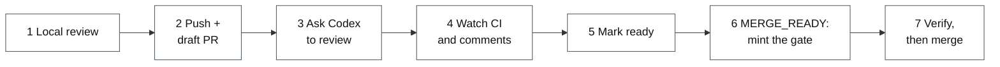
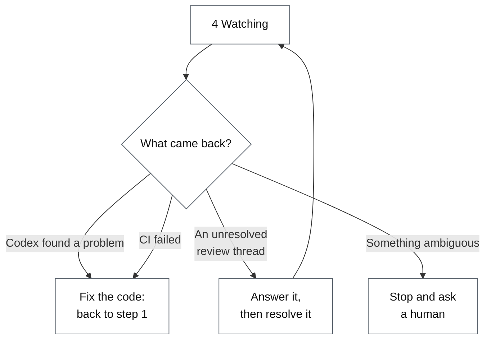

# How Review Bridge reviews a change

Describes Review Bridge v0.24.0.

This is the narrative introduction: what happens to one change from commit to
merge-ready, and why each step exists. For installation, see the
[README](../README.md) and the pages under [install/](install/); for every
tool and error code, see the [reference](reference.md).

## The problem it solves

AI-written code needs review before it merges. But "it was reviewed" is easy
to fake, usually by accident:

- the code keeps changing while the review happens, so the verdict describes
  something other than what ships;
- the model that wrote the code reviews its own work and finds it fine;
- a reviewer says "CI was green" without having looked, or having looked at a
  state that is minutes stale.

Review Bridge's answer: **every step leaves evidence a machine can check.**
Who reviewed, exactly which bytes they reviewed, what CI said at the time —
all of it is recorded, and later steps refuse to proceed when the record does
not hold up.

---

## When everything goes well

A change moves through seven steps. Two words used throughout: the **driver**
is the model (or person) calling the tools, and the **ledger** is the
server-side record the tools write — the driver proposes, the ledger decides
what counts.

**1 — Local review.** The first gate, before the code leaves your machine.
The system captures an **immutable snapshot** of the change and hands it to a
reviewer that had no part in writing it. The reviewer reads the snapshot,
never your live working tree, and submits structured findings. No findings
means `CLEAN`.

You choose the reviewer — a Codex process that `launch_local_reviewer` starts
with the [model from the Codex configuration at high effort](reviewer-configuration.md),
a fresh Claude Desktop conversation, a new Codex task, or an isolated Hermes or
DeepSeek Harness profile — though a change headed for publication takes a
Codex review by default, with any other provider read as a second opinion
beside that gate rather than in place of it. A snapshot may also capture
uncommitted working-tree state.

The immutable patch is measured as added plus deleted lines, and the review
reports the total against the default budget and the remaining headroom; it
does not block, because the operator is already present to decide on a split.

Note that this gate attests **snapshot consistency**, not test results:
finalizing it re-checks that the tree still matches what the reviewer saw.
The deterministic test gate lives later, in step 4, where CI results are
provider evidence rather than the author's word.

**2 — Push and open a draft PR.** What gets pushed must be byte-for-byte the
head that passed review: the publication ledger binds the gate's head and
reads `MERGE_READY` only while the pull request's head equals it. The PR starts as a **draft**, so
reviewers are not looking at it while its evidence is collected.

A repository in Git's sha256 object format can run a full local review and
reach the local gate, but it cannot go further. GitHub hosts no sha256
repository, so authorizing a remote-only publication and starting a
publication each refuse it with `REPOSITORY_OBJECT_FORMAT_UNPUBLISHABLE`.

**3 — Ask Codex to review.** `start_publication` binds a baseline of the
existing Codex feeds; the server then composes the request comment — with a
correlation marker — and the driver posts it verbatim and binds the posted
comment to the ledger. The marker is how a later result is recognized as
answering *this* request rather than one from last week; a crash between
posting and binding is caught by unbound-request detection.

**4 — Watch.** Periodically the driver collects the PR's complete state in
one pass — check runs, Codex results, review threads — and records it in the
ledger. The ledger derives a status from each observation.

**5 — Mark ready.** Leaving draft is your call: click "Ready for review" once
the local gate passed, Codex returned a clean correlated result, every
required check succeeded, and every review thread is resolved. A draft never
reads `MERGE_READY`.

**6 — `MERGE_READY`: mint the gate.** One more fresh observation confirms
nothing moved, and `finalize_publication_gate` issues an audited gate that
expires five minutes after the oldest source collection in that observation.

**7 — Verify, then merge.** Immediately before the merge,
`verify_publication_gate` re-checks the gate against the current ledger; only
`valid: true` authorizes it, and the merge is pinned to the verified head.
Merging stays an explicit operator decision.

---

## When things do not go well

Step 4 rarely passes on the first try. The common cases:

**Fixing code restarts the pipeline.** A new commit is a new head, and a new
head needs a new local review and a new publication ledger. Previous verdicts
do not carry over — deliberately. The new review is a successor by default:
its reviewed unit is the fix delta over the head the earlier publication
gated.

**Threads are answered before they are closed.** An unresolved review thread
keeps the ledger short of `MERGE_READY`. Reply on the thread with the commits
that addressed it, then resolve it, so its history shows who closed it and on
what grounds.

**Ambiguity stops the run.** An uncorrelated Codex result or an unbound
request reads `GITHUB_REVIEW_UNKNOWN`. The ledger names the exact requests
and results involved, and only a human's direct acknowledgement of that full
set lets a fresh request go out. Nothing guesses.

---

## Details worth knowing

**Why the snapshot matters so much.** A verdict has to bind to exact bytes.
The snapshot carries the full diff plus a byte-range index per file, so a
reviewer can read only what it cares about — but everyone reads the same
immutable thing, and the index is derived fresh from the stored patch on
every read rather than stored where it could drift.

**How round two works.** Local review is capped at two rounds: the reviewer
files findings, the author answers every one (`fixed`, `rejected`, or
`human_required`, each with a rationale), and the reviewer re-checks against a
new snapshot, dispatching each prior finding as resolved, rebuttal-accepted,
or still open. Round two is also when the reviewer first reads the author's
design rationale, after round one formed its findings from the code alone, so
a mismatch between the two shows where the code does not carry its intent.
A rebuttal that stays open escalates to a human. A fix judged
incomplete, or a new issue, goes back to the author, who addresses it and
starts a fresh full review carrying only the bare finding as a scope hint. There is no third round for the same review ID.

**Why some reads refuse to paginate.** Paginated reads do not describe one
moment. If page one says "checks green" and a check fails while you fetch
page two, the assembled "complete" picture is fiction. So the resources where
a single deciding value matters — check runs, commit statuses, review
threads — are read in one request each, and a response that indicates another
page **fails the collection** rather than walking it. The three comment and
review feeds are walked page by page, but each page's provenance is recorded
and the adapter validates the walk's completeness before anything is decided
from it.

**The report is for people, not for the ledger.** `render_review_report`
writes one review's ledger, and its publication ledger when there is one, as
Markdown beside the ledger and returns a receipt rather than the text. The
packaged `scripts/review-report.mjs` prints a brief by default: the terminal
state and where the review goes next, a fact table, the findings still open,
and the round-level facts. `--full` prints the full rendering the tool writes.
The workflow skill renders the report once `LOCAL_GATE_PASSED` is recorded and
again once a publication reads `MERGE_READY`, and opens it in Plannotator when
that tool is on PATH. Rendering changes no ledger, consumes no round, and
touches no gate; the report is a projection of the ledger, not evidence.

**The workflow skill loads one route at a time.** The packaged
`review-bridge-workflow` skill is a router: a table maps the current task —
prepare a review, handle findings, finish, or publish — to one reference
page, and the agent reads only that page and the references it calls for at
the current step. A review loads only its selected provider's dispatch page. The boundaries that
hold in every mode stay in the skill itself.

**Templates are packaging, not the capability boundary.** The repository
ships install templates for a Codex plugin, a Claude Desktop reviewer
extension, and Hermes and DeepSeek Harness profiles. The author side is the same server started
with `--role author`, and any MCP client — Claude Code included — can drive
it; a small script importing the modules directly works too.

---

## What works today

Everything above is implemented and tested: local review with four isolated
reviewer providers, and publication with baseline and atomic observations,
an expiring gate, and verification immediately before the merge.
