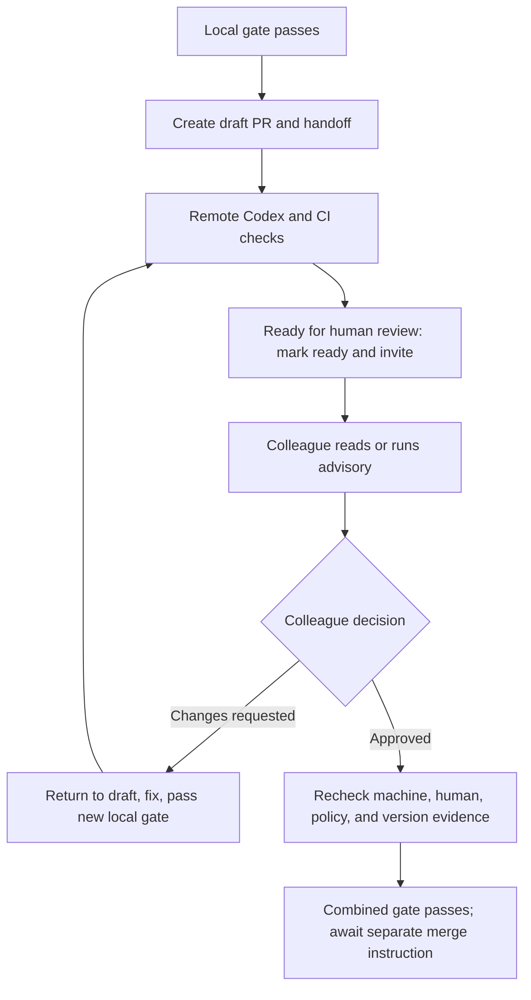

# RFC 0005: Peer Review and PR Handoff

| Field | Value |
| --- | --- |
| Status | Draft |
| Authors | Review Bridge contributors |
| Created | 2026-10-16 |
| Target release | TBD |
| Related | RFC 0001, RFC 0003 |

## Summary

After local review and PR creation, Review Bridge should help a colleague pick up the
review. The author prepares a short handoff; the colleague reads the PR directly or runs
an independent advisory review in their own environment. Feedback and approval remain on
GitHub. Review Bridge records which code version each decision concerns and, after further
commits, distinguishes proposed fixes from decisions still awaiting confirmation.

Phase 1 delivers handoff materials, a colleague-facing PR review entry point, and human
review status. Phase 2 introduces an explicitly enabled combined gate. Machine checks
passing, a colleague approving, and repository approval requirements being satisfied
remain three separate facts.

This RFC proposes new capabilities. Its new tools and states are not implemented. Existing
local review, advisory panels, and publication gates provide the foundation.

## Motivation

Local review reduces obvious defects before a colleague sees them, but the colleague still
needs to understand the requirement, tradeoffs, and system impact. A CLEAN verdict alone
does not identify where to start reading or which assumptions need scrutiny. A complete AI
conversation adds reading cost and can bias an independent assessment.

The current implementation provides these foundations and leaves these gaps:

| Area | Existing capability | Proposed addition |
| --- | --- | --- |
| Author handoff | `render_review_report` renders the review ledger | A short PR summary, reading guide, and questions for a colleague |
| Assisted peer review | Advisory panels freeze and independently review an external PR | A PR URL entry point and a clear colleague workflow |
| Feedback tracking | Review threads are collected; threads with human participation cannot be resolved automatically | Separate collection of formal human reviews, with fix and confirmation links |
| Completion | Local gate, remote Codex, CI, and threads are checked | Separate human decisions and repository policy, followed by a combined gate |

Currently, `human_review_requirements` is empty and the Codex adapter treats only the
bound Bot's reviews as results. An ordinary human `CHANGES_REQUESTED` review is not an
independent gate condition. Any unresolved inline threads it creates block through the
thread check instead. The current `MERGE_READY` therefore does not mean that a colleague
approved. See [publication](../../src/publication.mjs), the [GitHub
adapter](../../src/github-adapter.mjs), and the [report and advisory
workflow](../review-flow.md).

## Goals

- Let a colleague start from a PR URL without sharing the author's local store.
- Make requirements, key code, validation, and questions for human judgment
  easy to find.
- Support direct code review and optional independent AI assistance.
- Bind handoffs, AI results, human decisions, and fixes to a PR and version.
- Preserve history and recompute status after new commits without presenting
  old approval as confirmation of new code.
- Use GitHub identities, comments, formal reviews, and native merge constraints.

## Non-goals

- A shared Review Bridge service or synchronization of private ledgers.
- Automatically submitting Approve or Request changes on a colleague's behalf,
  or closing human discussions.
- Converting local CLEAN or an advisory report with no findings into approval.
- Reimplementing CODEOWNERS, team permissions, and all ruleset evaluation in
  phase 1.
- Automatic merge, branch protection changes, or additional Slack or email
  notifications.
- Advisory delta rereview or automatic selection of arbitrary model panels in
  phase 1.

## User experience

### Author handoff

After the local gate passes and the PR exists, the author can ask:

> Prepare a peer review handoff for this PR. Once the automated checks pass,
> invite Alice and ask her to focus on API compatibility.

The client prepares a preview, then updates the PR and requests review within the user's
existing authorization. Without authorization for external writes, it stops after
preparing the local material. Existing authorization does not require repeated
confirmation.

The handoff should fit roughly on one screen, in this order:

1. **Problem and behavior:** a concrete before-and-after example.
2. **Reading guide:** up to five files or symbols, with a reason to read each.
3. **Tradeoffs:** design rationale, alternatives, and known limitations.
4. **Validation:** tests actually run and their results, distinguishing local
   execution from CI evidence.
5. **Questions:** specific business, compatibility, operational, or architectural
   judgments requested from the colleague.
6. **Version and history:** head SHA, local review summary, and optional brief
   history.

For example:

> This change returns an explicit error when retries are exhausted so callers
> stop waiting.
>
> Start with the error exit in `request()`, then read its two callers. Please
> check whether existing clients depend on the previous timeout behavior.
>
> Validation: the new regression case passes; CI is linked below. This handoff
> covers `<head SHA>`. Independent local review is complete; human approval
> remains separate.

The full report remains local audit material. The MVP publishes only a short summary
checked for appropriate content. Optional appendices must also omit absolute paths,
private source material, and model conversations. A report hash identifies content; it
does not establish authenticity.

### Colleague review

A colleague can review directly on GitHub without installing Review Bridge. With Review
Bridge installed, they can ask:

> Review this PR with Review Bridge, focusing on compatibility and error
> recovery. Give me the report first.

The entry point resolves the PR URL, reads the repository identity and current head, and
uses the existing advisory checkout to freeze the head and actual merge base. A handoff
carries an expected head. If the PR has advanced, show the mismatch and let the colleague
choose the new head or explicitly review the historical head if it is still available.
Never silently replace the version they were invited to review. A URL-only request uses
the head read and frozen for that run. If the target branch or base changes, recompute the
merge base and disclose any change to review scope before comparing assessments.

Show the scope and change size, and follow the existing provider, model, and
reasoning-effort selection flow. Reuse the existing two-member panel default; do not
launch reviewers before the required selection.

Every member reviews the same clean snapshot. Treat the PR description as the author's
unverified claim. Exclude author conversations, local findings, and other members'
conclusions from the initial independent reviewer context. After the members finish, the
colleague may compare their results with the author's handoff and history.

The report preserves agreement, unique findings, and conflicts. The colleague validates
and selects the issues to raise. Publish selected comments through their authenticated
GitHub account only after an instruction covering that specific report. Formal approval
and requests for changes remain the colleague's decisions. Re-read the head before
publishing; if it changed, identify the report as belonging to an older version and do not
post old line numbers against the new diff.

### Fixes and further review

On the author side, list feedback with its original links, proposed actions, and
disagreements needing discussion. A model may propose fixes, but record "the author
considers this fixed" separately from "the colleague confirmed it."

Follow the existing workflow when changing a ready PR: return it to draft under the
applicable authorization, then push the new commit after a new local gate passes. The
author may use a successor review when eligible. Update the handoff with fix commits,
changed behavior, and questions still awaiting confirmation, then request further review
when authorized.

The colleague's advisory mode does not support `prepare_rereview`. A new head requires a
new full advisory panel. A person may choose to read only the delta; that choice must not
be represented as advisory coverage of the new version.

## Detailed design

### Flow and responsibilities

GitHub holds collaboration facts; local ledgers hold observations and links. The authoring
client performs authorized GitHub writes. The MCP server continues to hold no GitHub
credentials.

Human review must be available before human approval. A new `ready_for_human` predicate
reuses local gate, remote Codex, CI, version, and conflict checks, but remains separate
from the existing pre-ready predicate. Blockers owned by the machine workflow must still
be cleared. Human discussions awaiting confirmation, threads of unknown provenance
requiring human judgment, and missing human approval do not prevent handoff. They remain
visible as pending work and block the applicable merge gate. `ready_to_merge` combines
human and repository approval requirements and still requires all threads to be resolved.

In particular, an open human thread awaiting confirmation after a fix must not strand the
PR in draft and prevent further review. Phase 1 leaves the old autonomous workflow
unchanged: when its pre-ready check is blocked by human threads, report the reason and let
the operator explicitly mark ready and request rereview. Phase 2 adds the separate handoff
predicate to the new protocol. Marking ready means the PR is available for review, not
that human feedback has been resolved.

### PR records and versioned observations

Add a separate peer review record keyed by `(GitHub host, repository_id, pr_number)`. The
host distinguishes numeric IDs on different GitHub instances; repository ID survives
repository renames.

A record spans successive heads without changing existing local review IDs or publication
ledgers. A proposed path is `peer-reviews/<host-key>/<repository-id>/<pr-number>/`, with a
safe directory name derived from the normalized host.

| Data | Key fields |
| --- | --- |
| PR identity | Host, repository ID, PR number, head repository ID, base/head branches |
| Handoff version | Head SHA, base tip, merge base, linked review/publication IDs, summary digest |
| Human observations | Revision, source, collection time, completeness, review ID, actor ID/type, state, commit SHA, submission/dismissal facts |
| Review requests | Requested user or team, action ID, target head, GitHub result |
| Policy observations | Current review decision, sources and digest of applicable approval rules, unknowns |
| Feedback links | Review/comment/thread IDs, author response, fix commits, subsequent colleague confirmation links |

Keep observations append-only and derive the summary from facts. Requested reviewers are
pending invitations, not the complete approval policy; an empty list does not mean
approval. GitHub removes a reviewer from that list after they submit a review. See the
[review requests API](https://docs.github.com/en/rest/pulls/review-requests).

A model may help associate natural-language feedback with fix commits, but label the
association as an author explanation or candidate link. Decisive states such as thread
resolution, review dismissal, and later approval must come from GitHub objects.

### Three status dimensions

| Dimension | Proposed states | Meaning |
| --- | --- | --- |
| `machine_status` | `PENDING / BLOCKED / PASSED / STALE` | Whether applicable machine reviews and checks still cover the current code |
| `human_status` | `NOT_REQUESTED / PENDING / CHANGES_REQUESTED / APPROVED / RECONFIRMATION_REQUIRED / UNKNOWN` | Observed formal colleague decisions and their version relationship |
| `repository_review_status` | `SATISFIED / UNSATISFIED / NOT_REQUIRED / UNKNOWN` | Whether current repository approval requirements are satisfied |

Track draft, closed/merged, conflicts, and unresolved threads separately. Show concrete
blockers rather than only a green status indicator.

In phase 1, `human_status` summarizes collaboration; it does not replace GitHub's approval
policy. Also show each colleague's decision. An effective human request for changes takes
precedence as `CHANGES_REQUESTED`; another person's approval does not erase it. For an
effective approval, distinguish the approved SHA from the current SHA. Return `UNKNOWN`
when validity cannot be established.

At minimum, reduction must follow these rules:

- An ordinary `COMMENTED` review does not erase a still-effective request for
  changes or approval.
- `DISMISSED` does not count as approval; retain the dismissed decision and
  current provider state.
- Bot results, author self-review, and "LGTM" in comment text do not count as
  formal peer approval.
- `reviewDecision: null` means neither passed nor approval-not-required by
  itself. Interpret it with the policy actually read.
- A policy with no approval requirement may yield `NOT_REQUIRED` while human
  status remains `NOT_REQUESTED`.
- Preserve old approvals after a head change without claiming the colleague
  reviewed the current head. Use `RECONFIRMATION_REQUIRED` when current
  coverage is unclear.

The combined gate supports explicitly selecting `repository` or `current_head_peer`
requirements. The former follows GitHub's native approval policy. The latter additionally
requires an effective approval of the exact current head from at least one designated
non-author User. Record the choice and member identities in the policy; do not infer them
from invitations. In repository mode, a policy with no approval requirement may pass
without showing "human approved."

GitHub accepting an older approval and a person reviewing the current head are different
facts. GitHub supports stale approval dismissal, CODEOWNERS, and approval of the most
recent reviewable push. Review Bridge reads these policies without silently changing their
meaning. See [GitHub branch
protection](https://docs.github.com/en/repositories/configuring-branches-and-merges-in-your-repository/managing-protected-branches/about-protected-branches).

### Collection consistency and recomputation

Extend the read-only collector to collect human reviews, requests, and policy separately.
Preserve the Codex adapter's role; do not remove its Bot filter and mix human reviews into
Codex result correlation.

Record each observation's collection interval and sources. Re-read PR identity, head,
base, and effective approval state before and after collection. Changes or insufficient
permissions make the observation incomplete. For mutable paginated resources such as
reviews, MVP gate evidence is limited to sets fully covered by one request. A next page
makes that evidence incomplete; reaching the end of pagination alone does not prove a
coherent decision. Support for multiple pages needs a separate stability design. The
display may show partial history, but it cannot pass a gate.

Matching reads do not provide transaction atomicity across GitHub APIs. Use short-lived
evidence, retain the earliest collection time, and recheck before merge. A merge operation
bound to the expected head and GitHub's own protections remain the final constraints.

Recompute on changes to head, base/merge base, applicable rules, review submission or
dismissal, requests, thread contents or resolution, and CI. An observation grants no
permanent permission; a previous green summary is not evidence for the next decision.

### External writes and crash recovery

Review invitations, handoff publication or updates, and selected review comments are
external actions. Persist intent, preflight, reconciliation, and completion, recording
authorization scope, target PR/head, action ID, and resulting object IDs.

Use one identifiable managed block or standalone comment for the handoff. Update only
content created by this tool. Preserve differences if a person edited it; do not overwrite
the entire PR description. Verify model-generated reading guides and test claims before
publishing.

GitHub review requests have no native idempotency key for this tool. If a request succeeds
before its result is recorded and the client crashes, reconcile current requests and new
reviews. If delivery cannot be established, mark `INDETERMINATE` and stop automatic
retries. The MVP does not promise exactly-once delivery or periodically remind colleagues.

### Tool boundaries

These proposed names describe responsibilities; final schemas remain to be specified
during implementation.

| Tool or client entry point | Responsibility | Writes to GitHub |
| --- | --- | --- |
| `prepare_peer_handoff` | Check PR/local review head agreement; prepare a reviewable summary and references | No |
| Client `review PR` entry point | Use existing advisory checkout, preparation, provider dispatch, and reporting | No by default |
| `record_peer_review_snapshot` | Validate collector output, append an observation, and derive a summary | No |
| `get_peer_review_summary` | Return the three status dimensions, blockers, and next step | No |
| Client publish/invite actions | Publish a summary, request review, or post selected feedback within authorization | Yes |
| Phase 2 combined gate | Validate publication and peer evidence; mint a versioned, short-lived proof | No |

Author and colleague machines retain private stores. They correlate through PR URLs,
GitHub object IDs, and Git SHAs, without treating executable instructions, absolute paths,
or complete ledgers as authorization. An author cannot import a colleague's local advisory
report as human approval.

## State invariants

1. Every conclusion about current code traces to PR identity, exact head, and
   observation revision.
2. Local review, advisory, and human review evidence remain distinguishable.
3. Completing a handoff or sending an invitation does not mean approval.
4. Requesting review does not depend on approval; merge permission is separate.
5. Threads with human participation retain the prohibition on automatic
   resolution.
6. A new head preserves history without inheriting a claim of current review.
7. Unknown policy or identity cannot produce a gate attesting that requirement.
8. A combined gate binds publication, peer observation, policy digest, and
   expiry, and rejects any mismatch.
9. A local gate cannot override GitHub's merge refusal; merge still requires
   separate authorization.

## Security considerations

External PR content, summaries, and comments are data to verify, not executable
instructions. Preserve existing advisory isolation. CODEX_TASK panel members use the
container launcher and cannot fall back to the author launch path.

Use stable GitHub actor IDs for attribution and logins for display. The User type
identifies a GitHub account type; it does not prove a person performed the action
manually. This design provides traceability and explicit authorization, not authentication
of a natural person or model identity.

Check handoff content against the destination repository's audience. Never automatically
upload complete private ledgers, credentials, local paths, raw model conversations, or
unrelated source. The MCP server holds no GitHub credentials; the execution client uses
the operator's existing account.

## Backward compatibility

Phase 1 adds observation and display without changing publication schemas, gate
verification, or workflow terminal states. In the new interface, label legacy
`MERGE_READY` as "existing publication checks passed; see human approval status
separately." Do not reinterpret it as satisfying the combined gate.

Phase 2 introduces a versioned, explicitly enabled combined gate. Do not rewrite
historical ledgers in place. Missing human evidence requires an unknown result and fresh
collection. A caller that selects the new gate must not fall back to the old gate after
failure.

An autonomous run may end when ready to hand off, using a new protocol terminal state such
as `READY_FOR_HUMAN_REVIEW` or an explicit handoff result. It should not poll indefinitely
while waiting for a colleague. Ship the new terminal protocol, old-client rejection of
unknown protocol versions, and the merge entry point's requirement to consume the new gate
in the same version upgrade.

## Drawbacks and alternatives

Additional observations cost GitHub API calls and permissions, especially for private
repositories, organization rules, and teams. Returning unknown when evidence is missing
reduces automation but avoids false approval claims.

Multiple dimensions are more complex than `MERGE_READY`. Default to one clear status
sentence and next step, with expandable evidence. Advisory review also adds model cost, so
it remains optional and uses the existing two-member default.

Alternatives are publishing only a local report, sharing the whole local store, or adding
human reviews to the Codex adapter. A report alone is easy to ship but lacks subsequent
confirmation. Store sharing adds cross-machine permission and consistency costs. Extending
the adapter conflates identities and result correlation. This proposal uses GitHub
collaboration facts and private local records.

## Unresolved questions

These questions do not block phase 1's read-only display:

- Should the handoff default to a managed PR description block or a standalone
  comment? Start with a comment to reduce conflicts with author edits.
- Should phase 2 default to repository policy or require a designated peer's
  approval of the current head? Prefer explicit repository configuration over
  silently strengthening existing rules.
- Should a formal request for changes from an uninvited reviewer trigger a
  stricter team rule than GitHub requires? Phase 1 displays it without deciding
  that the actor has authority to block merge.
- When should advisory delta review become available? Design it separately
  after the full PR entry point is stable; do not borrow successor evidence
  that requires a gated parent.
- How should completeness extend to multiple review pages and complex rulesets?
  Before phase 2 ships, list supported GitHub policies and return `UNKNOWN`
  outside that scope.

## Test plan

Test observable behavior and meaningful boundaries:

- Local CLEAN, advisory with no findings, absent reviews, and empty request
  lists never display human approval.
- A human `CHANGES_REQUESTED` review appears even without inline comments.
- `COMMENTED` preserves effective decisions; dismissal, reapproval, Bots, and
  author self-review remain distinguishable.
- Head, base, and policy changes trigger recomputation; older approvals remain
  traceable without masquerading as approval of the current head.
- Missing permissions, ambiguous nulls, pagination, and changes during
  collection cannot pass the new combined gate.
- A draft PR can be handed off without approval. Human threads awaiting
  confirmation after a fix do not deadlock rereview in the new protocol;
  unresolved threads still block merge.
- A changed head prevents publishing old line numbers; human participation
  prevents automatic thread resolution.
- A delivered invitation with a lost response enters reconciliation or an
  indeterminate state without duplicate notifications.
- Existing v1 ledgers remain readable; strict mode does not fall back to an
  old gate.
- Independent machines given the same PR URL, expected head, and frozen merge
  base obtain the same review scope without sharing stores. An advanced or
  retargeted PR produces an explicit mismatch rather than a silent substitution.

Use a small set of real examples to assess summary readability. Avoid large wording
snapshot suites. Protocol implementation needs behavior tests for state reduction,
evidence validation, and crash recovery.

## Rollout plan

| Phase | Deliverable | Acceptance criteria |
| --- | --- | --- |
| 1A | Local handoff summary and colleague PR advisory entry point | A colleague completes independent review from a PR URL; publishing respects authorization |
| 1B | Human review collection and three status dimensions | Requests for changes appear without inline threads; legacy gate behavior stays unchanged |
| 2 | Explicitly enabled combined gate and protocol upgrade | Supported policies have replayable evidence; unknown fails closed; no draft/approval deadlock |
| 3 | Fix summaries, rereview invitations, and feedback links | Colleagues can identify fixes and pending confirmations; human decisions are not automated away |

Pilot in the team's own repository. Observe whether colleagues find the reading guide
useful, summaries remain accurate, invitations duplicate, or completion is misreported.
After phase 1 acceptance, choose phase 2's supported policy scope and default
configuration.
